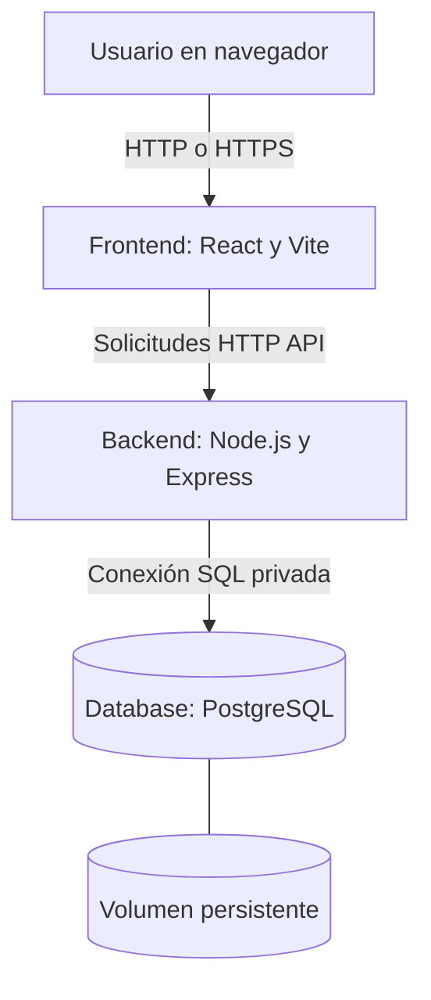
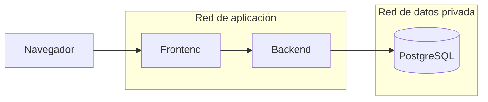

# Arquitectura lógica y de contenedores

**Estado:** línea base confirmada en cuanto a tecnologías y tres servicios; topología de redes, puertos y despliegue en evaluación.

## Vista de contenedores

**Precisión técnica:** el JavaScript del frontend corre en el navegador, por lo que las solicitudes a la API pueden originarse en el navegador; el contenedor frontend puede servir la aplicación y, si se elige, actuar como proxy de /api. Esto es un diseño a decidir, no una garantía de que todos los paquetes pasan primero por el servidor frontend.

## Responsabilidades
| Servicio | Responsabilidad | Qué no debe hacer |
| --- | --- | --- |
| Frontend | Vista, navegación, formularios y consumo API | Acceder a PostgreSQL o guardar secretos de servidor |
| Backend | Reglas de negocio, validación, autorización, API y persistencia | Confiar ciegamente en validaciones del navegador |
| Database | Integridad transaccional, esquema relacional y persistencia | Ser accesible directamente desde Internet |

## Topología de red propuesta

Propuesta de aislamiento en Compose: Frontend y Backend comparten una red de aplicación; Backend y Database comparten una red de datos. No publicar el puerto de PostgreSQL. La exposición del puerto del Backend depende de la decisión sobre proxy del Frontend. Nombres de servicio para DNS interno: `frontend`, `backend`, `database`.

## Ciclo de petición de ejemplo (técnico, no funcionalidad comercial)
1. El usuario abre la aplicación web.
2. El navegador ejecuta el frontend React.
3. El frontend solicita un recurso autorizado a una ruta HTTP del backend.
4. El backend valida la solicitud.
5. Si corresponde, consulta o escribe datos en PostgreSQL.
6. La API responde; el frontend presenta éxito, error o estado vacío.

## Persistencia y arranque
- Usar un volumen nombrado para datos PostgreSQL.
- Separar parámetros de desarrollo de los de despliegue.
- Definir healthcheck para la base y para la API, según implementaciones disponibles.
- Evitar confundir orden de arranque con disponibilidad real; Compose puede esperar condiciones de salud si está configurado.
- Versionar Dockerfiles y Compose, nunca contraseñas reales.

## Decisiones técnicas sin cerrar
- Servir compilación React con Nginx u otra alternativa.
- Política de proxy o acceso directo al backend en desarrollo.
- Puertos externos: por definir según ambiente.
- Versión exacta de Node, PostgreSQL e imágenes base: fijar al implementar.
- Estrategia de despliegue en nube para la entrega académica: pendiente.
- Protocolo HTTPS en escenario remoto: por concretar.
- Niveles de replicación: no previstos para la primera prueba local.

## Consideraciones cloud
Compose demuestra orquestación **local de múltiples contenedores**; no equivale a Kubernetes, alta disponibilidad ni escalado horizontal automático. Si el curso exige infraestructura cloud, ese hito se diseñará de manera independiente y con costos revisados.

Referencias oficiales: [Docker Compose Specification](https://docs.docker.com/reference/compose-file/).

Relaciones: [Frontend](04-DISENO-FRONTEND.md), [Backend](05-DISENO-BACKEND.md), [Database](06-DISENO-DATABASE.md).
