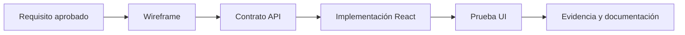

# Diseño del Frontend — React + Vite

**Estado:** guía de arquitectura, sin módulos ni pantallas aprobados.

## Responsabilidad del componente
Presentar información y permitir interacciones con el usuario a través de una API HTTP. No contiene lógica de integridad del servidor ni credenciales privadas.

## Organización de código propuesta (Codex debe validarla)
- `Frontend/src/app/`: configuración del arranque, navegación y proveedores globales.
- `Frontend/src/pages/`: vistas correspondientes a funcionalidades **aprobadas**.
- `Frontend/src/components/`: componentes reutilizables.
- `Frontend/src/features/`: agrupación opcional por caso de uso.
- `Frontend/src/services/`: cliente HTTP y acceso a API.
- `Frontend/src/styles/`: tokens y estilos.
- `Frontend/src/tests/`: pruebas de componentes e interacción.

No generar todas estas carpetas si no existe una necesidad real; mantener diseño KISS.

## Reglas de interfaz
- Diseño adaptable a escritorio y móvil según las necesidades aprobadas.
- Estados explícitos: carga, datos vacíos, error y confirmación.
- Validar entradas para experiencia de usuario; repetir validación crítica en servidor.
- Navegación clara y accesibilidad básica: etiquetas, foco, teclado y contraste.
- Manejo consistente de errores HTTP.
- No colocar secretos en variables expuestas al cliente.
- Evitar dependencias innecesarias hasta justificar su uso.

## Entregables de diseño antes de codificar una vista
| Artefacto | Contenido mínimo |
| --- | --- |
| Mapa de navegación | Pantallas aprobadas, rutas y transiciones |
| Boceto o wireframe | Estructura, contenido y acciones |
| Contrato API | Datos necesarios y manejo de errores |
| Estados de UI | Carga, error, vacío, éxito |
| Criterios de aceptación | Resultado que debe demostrar la vista |
| Pruebas | Acciones y casos negativos |

## Flujo propuesto

## Por definir con usuario
Identidad visual, pantalla inicial, lista de rutas, formularios, controles de accesibilidad prioritarios, autenticación y estados de sesión, necesidades de catálogo o compra y contenido legal. Ninguno se encuentra aprobado.

Véase [Contratos API](07-CONTRATOS-API-Y-FLUJOS.md) y [Requisitos](02-REQUISITOS-Y-ALCANCE-FUNCIONAL.md).

## S01 — pantalla técnica implementada

`Frontend/src/App.jsx` presenta únicamente diagnóstico, sin módulos comerciales. El cliente usa `/api/health` relativo, no-store, valida HTTP 200 y JSON sano. Carga, éxito y error accesibles con status/alert; reintento deshabilitado durante carga. Cancelación al desmontar, límite de 4000 ms e ignorar respuestas obsoletas evitan éxitos tardíos. `npm --prefix Frontend test`: 11/11; `npm --prefix Frontend run build` aprobado. No se ha validado aún en contenedores/navegador real.
