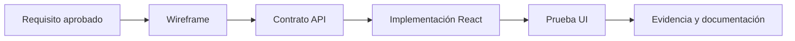

# Diseño del Frontend — React + Vite

**Estado actual:** S01 conservado; V2 Incremento4 arte/ficha/móvil implementado para revisión local, API y catálogo sintético conservados. Los apartados anteriores registran su evolución histórica. Sin publicación ni autorización para Incremento5. [Evidencia actual](FRONTEND-V2-INCREMENTO-4-PRUEBAS.md).

## Responsabilidad del componente
Presentar información y permitir interacciones con el usuario a través de una API HTTP. No contiene lógica de integridad del servidor ni credenciales privadas.

## Organización de código propuesta (Codex debe validarla)
- `Frontend/src/app/`: configuración del arranque, navegación y proveedores globales.
- `Frontend/src/pages/`: vistas correspondientes a funcionalidades **aprobadas**.
- `Frontend/src/components/`: componentes reutilizables.
- `Frontend/src/features/`: agrupación opcional por caso de uso.
- `Frontend/src/services/`: cliente HTTP y acceso a API.
- `Frontend/src/styles/`: tokens y estilos.
- `Frontend/src/tests/`: pruebas de componentes e interacción.

No generar todas estas carpetas si no existe una necesidad real; mantener diseño KISS.

## Reglas de interfaz
- Diseño adaptable a escritorio y móvil según las necesidades aprobadas.
- Estados explícitos: carga, datos vacíos, error y confirmación.
- Validar entradas para experiencia de usuario; repetir validación crítica en servidor.
- Navegación clara y accesibilidad básica: etiquetas, foco, teclado y contraste.
- Manejo consistente de errores HTTP.
- No colocar secretos en variables expuestas al cliente.
- Evitar dependencias innecesarias hasta justificar su uso.

## Entregables de diseño antes de codificar una vista
| Artefacto | Contenido mínimo |
| --- | --- |
| Mapa de navegación | Pantallas aprobadas, rutas y transiciones |
| Boceto o wireframe | Estructura, contenido y acciones |
| Contrato API | Datos necesarios y manejo de errores |
| Estados de UI | Carga, error, vacío, éxito |
| Criterios de aceptación | Resultado que debe demostrar la vista |
| Pruebas | Acciones y casos negativos |

## Flujo propuesto

## Por definir con usuario
La sección local al final registra las rutas y controles del prototipo autorizado. Identidad definitiva, autenticación, compra y contenido editorial real siguen pendientes de refinamiento.

Véase [API implementada en Backend](05-DISENO-BACKEND.md) y [Requisitos](02-REQUISITOS-Y-ALCANCE-FUNCIONAL.md). El documento general de contratos de módulos futuros aún no está publicado.

## S01 — pantalla técnica implementada

`Frontend/src/App.jsx` presenta únicamente diagnóstico, sin módulos comerciales. El cliente usa `/api/health` relativo, no-store, valida HTTP 200 y JSON sano. Carga, éxito y error accesibles con status/alert; reintento deshabilitado durante carga. Cancelación al desmontar, límite de 4000 ms e ignorar respuestas obsoletas evitan éxitos tardíos. `npm --prefix Frontend test`: 11/11; `npm --prefix Frontend run build` aprobado. No se ha validado aún en contenedores/navegador real.

### Docker S01

Build multi-stage Vite y Nginx oficial fijado; sin node_modules de desarrollo en runtime. `/api/` mantiene la ruta y no entra al fallback SPA. Healthcheck wget usa `-Y off` solo para loopback, porque BusyBox heredaba el proxy HTTP cloud y devolvía 403 sin alcanzar Nginx; el proxy externo y CA siguen activos.

### Verificación de integración S01

El navegador Chromium real carga los assets construidos y muestra salud con respuesta de Backend/PostgreSQL. Las pruebas de integración verifican `/api/unknown` como 404 JSON, no HTML SPA, y proxy 502/504 cuando Backend está detenido. El estado de UI se actualiza al reintentar; no se usa polling ni salud simulada.

## Prototipo local HU-001/HU-002

En `npm run dev` o `npm run build:local` se muestra catálogo sintético en `/`, ficha en `/obras/:id` y diagnóstico S01 en `/estado`. Componentes WorkCard/WorkCover, SearchForm y mensajes de estado son reutilizables; useResource limita esperas a 4000 ms y cancela/ignora respuestas obsoletas. La búsqueda y el formato se reflejan en la URL y se conservan al volver del detalle, con enlaces nativos y soporte de navegación atrás. API relativa vía proxy Vite; ningún dato de catálogo se importa del Backend ni se duplica en React.

Las composiciones gráficas CSS/SVG son marcadores propios de demostración, no portadas reales. Fuente sintética y ausencia de persistencia se declaran en catálogo y ficha. Sin enlaces a autenticación, lector, tienda o gamificación. Diseño móvil/escritorio y salto de teclado al contenido verificados en Chromium; 30 pruebas Frontend aprobadas. La compilación predeterminada sigue mostrando S01; build:local usa internamente modo prototype porque Vite reserva el nombre local para archivos .env.local.

Revisión final local: el formulario conserva su instancia y foco al enviar filtros; borrador y filtros aplicados se controlan por separado. Regresión observada RED→GREEN, 31 pruebas Frontend aprobadas. Así el teclado no vuelve al inicio de la página después de buscar.

## Rediseño azul nocturno — HU-001/HU-002

Autorizado el 2026-11-04 en `feat/ui-azul-nocturno`, desde catálogo `4794803`. Sustituye la apariencia verde provisional por fondo `#0B1020`, superficies `#131D30` y azul `#2563EB`, con cian/azul claro/violeta de acento. `NightArtwork` y `CoverArtwork` son composiciones SVG originales con `useId` para evitar gradientes compartidos.

Header y hero acceden al mismo buscador; footer enlaza solo rutas existentes. Al llegar mediante `#catalog-query`, el campo recibe foco después del montaje dinámico de React. Portadas 3:4, grid 6/3/2/1 según anchura, foco visible y movimiento reducido. CSS de salud local se acota a `.catalog-shell`: `App.css` y el build S01 se conservan. Cliente, hooks, estados, API, datos y navegación mantienen su comportamiento.

Cuatro pruebas nuevas de acceso/navegación/foco: **35 Frontend aprobadas**. Chromium verificó 1440/768/390/320 px, teclado, proporción, contraste, búsqueda/ficha/historial y estados sin errores JavaScript. `Frontend/test/browser/dark-catalog-smoke.py` permite repetir la comprobación con Playwright opcional y servidores nativos activos. Evidencia y límites en [reporte del rediseño](UI-AZUL-NOCTURNO.md).

Revisión de presentación: el selector de tablet se amplió a 170px para mostrar “Todos los formatos” completo. Una comprobación Chromium de espacio para la opción seleccionada reprodujo el recorte antes del cambio y pasó después; suites completas 45 Backend/35 Frontend y ambos builds aprobados.

## Sistema Visual V2 — Incremento2

`CatalogApp.jsx` importa tokens → base → responsive. Tokens se acotan a body.catalog-mode/catalog-shell, sin tema global ni modificación de App.css. Palette/semánticos, tipografía, espaciados, tamaños, radios, profundidad y movimiento centralizados; breakpoints existentes1199/800/599/359 en un CSS exclusivo. Componentes, props, rutas, API y arte original intactos. Metadatos informativos≥12px, campos48px con interior compatible y foco visible también en destinos tabIndex.

45 Backend/35 Frontend, ambos builds y Chromium4anchuras aprobados; build S01 idéntico por SHA256. Guía32 documenta el sistema y reporte Incremento2 conserva capturas antes/después. Objetivo AA, no certificación. Sin push/PR ni Inicio/Explorar nuevos; detener antes de Incremento3. [Guía](32-GUIA-VISUAL-FRONTEND-V2.md) · [Evidencia](FRONTEND-V2-INCREMENTO-2-PRUEBAS.md).

## Inicio y Explorar V2 — Incremento3 (2026-11-06 UTC)

`CatalogApp` reutiliza rutas por pathname/enlaces nativos: Inicio `/`, catálogo `/explorar`, ficha `/obras/:id`, diagnóstico `/estado`,404. `catalog-navigation` concentra enlaces y compatibilidad de consultas antiguas en `/`. `HomePage` usa el mismo cliente API/hook; `home-sections` deriva orden y géneros sin datos de respaldo/personalización. `Hero` reutiliza arte original. SearchForm comparte foco de fragmento; WorkCard permite nivel de encabezado3 en Inicio y2 en Explorar. API, seis obras, SVG y servicios no cambian.

CSS de importación: tokens → base → HomePage → responsive.45 Backend/45 Frontend y ambos builds aprobados; Chromium dev y preview compilado validan recargas/filtros/historial/estados/accesibilidad acotada en cuatro tamaños. Nginx conserva fallback, pero Docker construye S01, no V2. Sin Docker ejecutado ni publicación. [Reporte y capturas](FRONTEND-V2-INCREMENTO-3-PRUEBAS.md). Parar antes de Incremento4.

## Arte, ficha y móvil V2 — Incremento4

Sobre `ddf908e`, ficha usa grid por áreas, título/formato antes de portada móvil, metadatos semánticos y avisos neutrales de vacíos válidos. Se preserva validación estricta en el cliente API, URL/regreso/hook; `titleLabel` se comparte sin crear registros alternativos. Géneros vacíos no generan enlaces sin nombre. WorkCover limita solo su título decorativo; texto esencial externo no se trunca. SVG existentes refinados y estrellas agrupadas, sin recursos externos nuevos. Fallback gráfico usa Object.hasOwn para evitar propiedades heredadas.

45 Backend/58 Frontend, builds y Chromium dev/preview aprobados con fixtures largos/vacíos/inválidos y rotación simulada. API/Backend/Database/Docker/dependencias/tokens/rutas no cambian. [Reporte actual](FRONTEND-V2-INCREMENTO-4-PRUEBAS.md). Incremento5 no autorizado.
