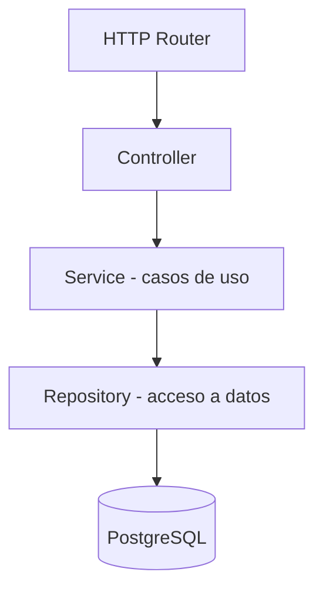

# Diseño del Backend — Node.js + Express

**Estado:** decisiones estructurales propuestas; sin endpoints de negocio definidos.

## Objetivo
Centralizar las reglas de negocio, validar operaciones, gestionar acceso a datos y publicar una API documentada para el frontend.

## Arquitectura interna propuesta: monolito modular
No crear microservicios adicionales: existe un solo contenedor Backend. Se recomienda separar responsabilidades dentro de la aplicación.

## Organización de código candidata
- `Backend/src/app.`* : ensamblado del servidor y configuración.
- `Backend/src/routes/`: rutas HTTP.
- `Backend/src/controllers/`: traducción solicitud/respuesta.
- `Backend/src/services/`: lógica de casos de uso.
- `Backend/src/repositories/`: consultas a PostgreSQL.
- `Backend/src/middlewares/`: errores, validación y eventual autenticación.
- `Backend/tests/`: pruebas unitarias e integración.

Si el tamaño inicial es pequeño, Codex puede simplificar esta estructura sin mezclar responsabilidades. No crear módulos de negocio que aún no fueron aprobados.

## Reglas técnicas a decidir/implementar
1. Versionar la API cuando el contrato se consolide (propuesta: `/api/v1`).
2. Validar todas las entradas del lado servidor.
3. Usar consultas parametrizadas, nunca SQL concatenado con datos externos.
4. Definir esquema uniforme para errores y registrar mensajes de diagnóstico sin secretos.
5. Separar variables de entorno y validar configuración al arrancar.
6. Realizar operaciones relacionadas bajo transacciones cuando sean necesarias.
7. Implementar límites y autorización cuando se aprueben identidad y roles.
8. Proponer endpoint técnico de salud como parte del primer incremento; **no afirmar que existe**.

## Definición de terminado para un endpoint
- Existe requisito aprobado y contrato documentado.
- Entradas, salidas, códigos de estado y errores especificados.
- Validación y autorización aplicadas cuando proceda.
- Pruebas de éxito y error reproducibles.
- Se actualiza [Contratos API](07-CONTRATOS-API-Y-FLUJOS.md) y [Estado](ESTADO-DEL-PROYECTO.md).

## Pendientes
Modelo de autenticación, sesiones, roles, reglas del comercio, endpoints concretos, estructura de errores definitiva, estrategia de logging y límites de uso. No implementar esos elementos por conjetura.
