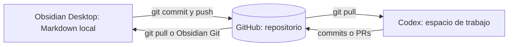

# Puente documental Codex ↔ GitHub ↔ Obsidian

## Qué puede leer cada herramienta
- **Codex:** el código y los documentos que estén en el espacio de trabajo o repositorio que tenga abierto. No debe asumirse que puede abrir la bóveda local de Obsidian del usuario.
- **Obsidian Desktop:** notas Markdown de carpetas locales abiertas como bóveda. Su contenido no se envía a GitHub hasta realizar commit y push (manual o con Obsidian Git).
- **Chat con Vaultcraft:** puede analizar archivos que el usuario comparta o que estén accesibles mediante conectores; no tiene automáticamente acceso directo al disco local de Obsidian.
- **GitHub:** fuente común versionada. Los chats no sincronizan sus mensajes entre sí.

## Estrategia recomendada
**El repositorio es la fuente oficial del proyecto.** Para evitar duplicidad, las notas técnicas que Codex debe consultar se guardan en `docs/` o `docs/obsidian/`. La bóveda académica de las diapositivas S04–S11 puede mantenerse local y separada.

## Configuración inicial en Windows
1. Clonar `https://github.com/JoseB-H/Sistema-EcomerceGeneral.git` a una carpeta local segura.
2. Abrir esa carpeta en VS Code y en Obsidian con «Abrir carpeta como bóveda», o usar solo la carpeta `docs/` como bóveda si se prefiere.
3. Configurar Git/Obsidian Git para sincronizar tras guardar. Primero **pull** antes de editar o resolver conflictos.
4. **No copiar** PDFs de clase, credenciales, `.env`, datos personales, archivos privados ni contenidos con derechos restringidos al repositorio público.
5. Antes de asignar una tarea a Codex, confirmar que la nota fue enviada a GitHub y aparece en la rama correcta.

## Contrato de contexto para Codex
Al iniciar una nueva sesión o tarea:
1. Leer `AGENTS.md`, `docs/00-INDICE-DOCUMENTAL.md`, `docs/16-MARCO-SCRUM.md`, `docs/18-PUENTE-CODEX-OBSIDIAN.md`, `docs/ESTADO-DEL-PROYECTO.md`.
2. Consultar las solicitudes y requisitos vinculados al Issue de la tarea.
3. Distinguir **Confirmado / Propuesto / Pendiente / Implementado / Verificado**.
4. No desarrollar funciones basadas en un resumen de chat que no esté registrado ni aprobado.
5. Al finalizar, actualizar `docs/` y el estado del ítem; señalar commit y pruebas.
6. No alterar notas personales o de clase salvo petición.

## Regla para solicitud nueva
- Crear archivo en `docs/solicitudes/SOL-AAAAMMDD-tema.md` con la [plantilla](solicitudes/PLANTILLA-SOLICITUD.md).
- Sincronizar al repositorio.
- Registrar como Product Backlog Item, manualmente o mediante una automatización habilitada.
- Revisar prioridad, dependencias, aceptación y asignación de sprint durante planificación.
- **No asignar automáticamente un sprint nuevo por cada nota.**

## Protocolo de actualización documental
Cambio de UI → diseño y aceptación Frontend.
Cambio de API → contrato, Backend y pruebas.
Cambio de datos → diccionario, modelo y migraciones.
Cambio de infraestructura → Docker/arquitectura/operación.
Cambio de alcance → visión, RF/HU, Product Backlog y ADR si corresponde.

## Limitaciones actuales
- La sincronización local de Obsidian **aún no está configurada**.
- No existe acceso confirmado de Codex a una bóveda local.
- No está habilitada la creación automática de GitHub Issues por notas; requiere workflow y permisos.
- El repositorio es público.

## Cómo comprobar el enlace
Crear una nota de prueba no sensible, hacer push, abrirla desde GitHub, pedir a Codex leerla por ruta y verificar que la cite correctamente; modificarla desde Codex en un PR y hacer pull en Obsidian.
