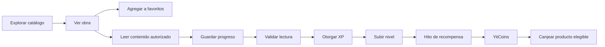

# YitVerse — propuesta funcional v0.1

**Repositorio:** Sistema-EcomerceGeneral  
**Fecha:** 2026-11-03  
**Estado:** visión del producto confirmada por el usuario; reglas detalladas y alcance del MVP todavía en definición.  
**Nombre comercial:** YitVerse (**provisional**, sin confirmación de marca).

## 1. Visión del producto

Plataforma web de comercio electrónico orientada inicialmente a **manhwas, mangas y otros formatos de lectura vinculados al universo del anime**, con posibilidad de ampliar en el futuro a otras lecturas. Combina descubrimiento y seguimiento de obras, compra de ediciones físicas y accesorios especiales, y un sistema de progresión mediante **experiencia (XP), niveles y YitCoins**.

**Propuesta de valor:** la lectura sostenida y legítima permite progresar en una cuenta de usuario y alcanzar hitos que otorgan créditos internos canjeables por artículos elegibles de la tienda.

> Se documenta una idea de negocio y su alcance futuro. Ningún flujo implica que esté implementado o que los contenidos digitales estén licenciados.

## 2. Alcance expresamente solicitado

- Catálogo visible de obras editoriales y formatos asociados a manga/manhwa/anime, extensible a otros tipos de lectura.
- Cuenta de usuario como requisito para acumular progreso y XP.
- Favoritos, historial de obras leídas y seguimiento/continuación de lectura.
- Lectura digital dentro de la plataforma **solo de materiales sobre los que exista derecho de distribución y lectura digital**.
- XP por actividad de lectura válida; niveles de progreso.
- Recompensas en YitCoins al superar hitos de nivel; el usuario mencionó **cada 10 niveles como ejemplo**, no como regla final cerrada.
- Compra o canje con YitCoins de mercancía exclusiva y ediciones físicas elegibles.
- Tienda de accesorios exclusivos y ediciones físicas para coleccionistas.

## 3. Distinción crítica: obra, lectura y producto

Una **obra** es la creación intelectual (serie o título). Puede tener capítulos y versiones. Una **edición** es una forma concreta de publicar esa obra (digital licenciada, tomo físico, edición coleccionista, etc.). Un **producto de tienda** es un elemento comercializable, con precio monetario, elegibilidad de YitCoins y existencias si es físico. Un **accesorio** puede ser producto sin pertenecer a una obra. No mezclar capítulo, obra y SKU en una sola tabla.

Una **lectura realizada** no es una compra. Registrar progreso no confiere automáticamente acceso legal a contenido digital.

## 4. Actores

| Actor | Intención confirmada | Lo que falta decidir |
|---|---|---|
| Visitante | Explorar contenido visible (propuesta razonable) | ¿Puede ver detalles sin cuenta? |
| Usuario registrado | Favoritos, historial, progreso, XP, niveles, YitCoins | Autenticación, privacidad y permisos |
| Operador de tienda | Necesidad inferida para administrar publicaciones y pedidos | Quién lo ejerce y qué permisos tiene |
| Administrador | Rol técnico propuesto | Acciones exactas, auditoría y control |

**Confirmado:** deberá existir registro de usuarios para acumular experiencia. Los roles no mencionados por el usuario siguen como propuesta.

## 5. Módulos

| ID | Módulo | Valor | Situación |
|---|---|---|---|
| M-01 | Catálogo editorial | Descubrir obras, formatos y detalles | Intención confirmada |
| M-02 | Cuenta y perfil lector | Persistir preferencias y progreso | Intención confirmada |
| M-03 | Favoritos, historial, seguimiento | Retomar y organizar lecturas | Intención confirmada |
| M-04 | Lector digital autorizado | Leer capítulos legalmente disponibles | Sujeto a derechos |
| M-05 | XP y niveles | Recompensar actividad de lectura válida | Intención confirmada, reglas pendientes |
| M-06 | Billetera YitCoins | Consultar saldo y movimientos | Intención confirmada, economía pendiente |
| M-07 | Tienda de físicos y accesorios | Comercializar coleccionables | Intención confirmada, operación pendiente |
| M-08 | Canje con YitCoins | Obtener productos elegibles | Intención confirmada, reglas pendientes |
| M-09 | Administración del contenido y ofertas | Mantener catálogo, precios, stock y canjes | Propuesto |
| M-10 | Nuevos géneros editoriales | Ampliar más allá de manga/manhwa | Futuro |

## 6. Recorrido de usuario propuesto

Este flujo combina comportamiento **deseado** con partes sujetas a diseño. Guardar progreso y reconocer XP deben estar desacoplados para evitar manipulación.

## 7. MVP recomendado para conversación (NO APROBADO)

**Tramo A: demostración técnica** — tres contenedores conectados, registros editoriales de ejemplo no protegidos, catálogo de prueba, persistencia.

**Tramo B: biblioteca personal** — cuenta, favoritos, seguimiento e historial, sin asumir permisos de contenido.

**Tramo C: gamificación** — XP auditada, niveles, balance y canjes de prueba con recursos sintéticos.

**Tramo D: tienda** — artículos físicos y proceso de pedido según reglas comerciales aprobadas.

Se puede reajustar este orden en Product Backlog sin crear un sprint para cada idea.

## 8. Reglas de comunicación entre chats

- Codex implementa únicamente Product Backlog Items refinados y seleccionados para un sprint.
- El chat «Servicios Cloud» revisa requisitos académicos y arquitectura técnica.
- Este chat documenta visión, requisitos, decisiones, UX y Scrum.
- GitHub contiene los archivos comunes; Obsidian los refleja tras sincronización Git local.

## 9. Dependencias legales y operativas

- Verificar licencias para mostrar portadas, fragmentos, capítulos completos, traducciones y material promocional.
- Definir procedencia legítima de ediciones físicas y accesorios de terceros.
- No mostrar ni cargar contenido de obras ajenas en la aplicación sin autorización o licencia adecuada.
- Revisar normativa comercial, consumidor, datos personales y tratamiento de créditos promocionales antes de una operación real.

Ver [experiencia y YitCoins](22-REGLAS-XP-YITCOINS.md), [diseño UX](21-EXPERIENCIA-USUARIO.md), [conceptos de datos](23-MODELO-CONCEPTUAL.md) y [backlog](24-PRODUCT-BACKLOG-SCRUM.md).
