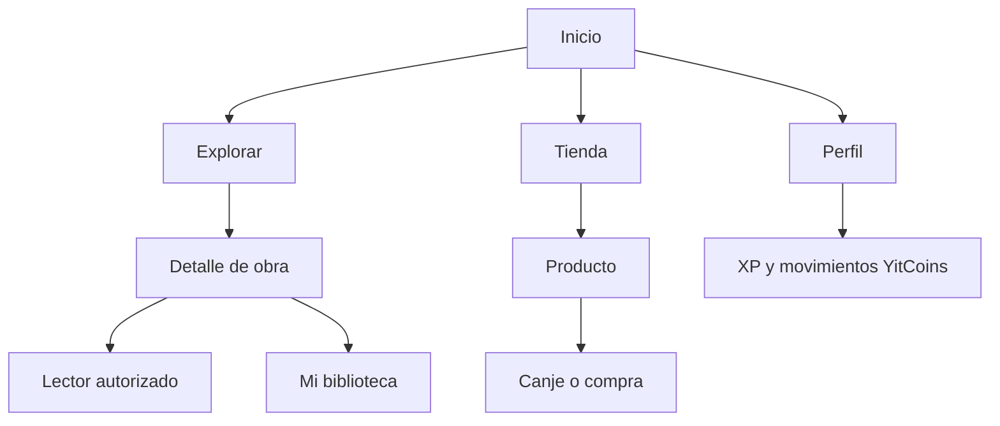

# Experiencia de usuario y estructura visual — v0.1

**Estado:** visión general propuesta; flujo local sintético Explorar → Ficha autorizado e implementado para revisión, con alcance al final de este documento. La identidad definitiva y otros módulos siguen pendientes.

## Principio rector

La interfaz debe sentirse como una biblioteca moderna y una tienda sin abrumar al lector. Prioridad: **leer y encontrar contenido fácilmente**. Gamificación visible, pero discreta; evitar barras, promociones y notificaciones que invadan la lectura.

## Navegación propuesta

| Sección | Objetivo | Contenido candidato |
|---|---|---|
| Inicio | Descubrimiento | Destacados, lecturas recientes si hay sesión |
| Explorar | Buscar obras | Género, formato, búsqueda, fichas |
| Mi biblioteca | Lectura personal | Favoritos, siguiendo, leídos, continuar |
| Tienda | Productos elegibles | Ediciones físicas, mercancía exclusiva, filtros |
| Perfil | Información personal | Nivel, XP, saldo YitCoins y movimientos |

En móvil, limitar accesos destacados y permitir menú contextual; no sobrecargar un menú fijo.

## Vistas preliminares (no aprobadas)
1. **Inicio:** cabecera simple, búsqueda, tarjetas con portada y título; no inventar popularidad, puntuaciones ni stock.
2. **Detalle de obra:** título, autor/editorial si se tiene derecho y dato verificado, descripción, formatos disponibles y acción de seguir o favorito.
3. **Lector:** lectura vertical/horizontal según contenido autorizado, controles discretos, indicador de capítulo, opción de continuar, accesibilidad.
4. **Mi biblioteca:** pestañas Favoritos / En seguimiento / Historial / Continuar; filtros si el volumen lo requiere.
5. **Tienda:** separar «Ediciones físicas» de «Accesorios» y mostrar disponibilidad, precio monetario, YitCoins requeridos si aplica.
6. **Perfil:** nivel actual, avance hacia siguiente nivel, saldo de YitCoins, historial de recompensas; sin gamificación que tape la cuenta.
7. **Área de gestión:** solo cuando roles y operaciones administrativas estén aprobados.

## Componentes reutilizables propuestos
- Tarjeta de obra (imagen con texto alternativo, título, tipo/formato, estado).
- Tarjeta de producto físico (imagen, variante, disponibilidad, precio y canje si procede).
- Barra XP compacta; detalle accesible por texto.
- Indicador de YitCoins con enlace a movimientos.
- Mensajes de estado: cargando, vacío, error, éxito, sesión caducada.
- Buscador con filtros progresivos y retorno de resultados.

## Reglas de ergonomía
- Tipografía legible, espaciado cómodo, contraste adecuado y navegación por teclado.
- Imágenes responsivas, carga diferida y alternativa textual; no llenar toda la pantalla de banners.
- Respetar `prefers-reduced-motion`; evitar animaciones constantes y ruido de gamificación durante lectura.
- Guardar progreso con señal clara de éxito/error, sin reclamar lecturas que no se verificaron.
- Favorecer reanudación de lectura sin pasos innecesarios.
- Permitir ver historial de YitCoins: razones de abono, débito y reversión.

## Prototipo de navegación

## Decisiones antes de dibujar pantallas finales
- ¿Lectura vertical estilo webtoon, paginada estilo manga, o ambas?
- ¿Catálogo público completo o limitado según sesión?
- ¿Temas claro y oscuro? ¿Color de identidad?
- ¿Tienda y lectura comparten una misma búsqueda?
- ¿Cómo se expresa la disponibilidad de los capítulos autorizados?
- ¿Qué apartados se consideran esenciales para la primera entrega?

**Próximos artefactos:** wireframe por flujo aprobado, mapa de navegación cerrado y pruebas de usabilidad antes de pedir componentes a Codex.

## Alcance visible del prototipo local autorizado

Para HU-001/HU-002 se implementa únicamente Explorar → Ficha → volver, y enlace técnico Estado de conexión. La navegación candidata de biblioteca/tienda/perfil sigue fuera de alcance y no aparece como botones inactivos. El catálogo combina buscador etiquetado, filtro de formato, tarjetas reutilizables y estados de carga/error/vacío; una URL directa desconocida muestra un estado no encontrado. Los datos son ficticios, sin ratings, stock, precios, autores reales ni capítulos. El diseño claro/verde inicial era provisional y fue reemplazado por la identidad azul nocturna solicitada posteriormente; no implica aprobación de todo el UX futuro.

## Identidad azul nocturna solicitada — 2026-11-04

Hero editorial con paisaje SVG propio y mensaje de descubrimiento, portadas ficticias verticales 3:4 diferenciadas, fondo `#0B1020`/superficie `#131D30`, azul `#2563EB` y acentos `#38BDF8`/`#60A5FA`/`#8B5CF6`. Navegación superior limpia y acceso al único buscador etiquetado; footer con rutas reales. Ficha, carga/error/vacío/404 y estado técnico comparten tema oscuro. Transiciones discretas solo si el usuario no pide movimiento reducido. No hay carrusel, autoplay, rankings, estadísticas inventadas ni botones de módulos futuros. Se elige esta composición dentro de la autorización de rediseño del usuario; revisión visual final pendiente. Olympus quedó inaccesible por proxy 403, por lo que se usa la organización descrita sin acreditar comparación visual ni copiar activos.
