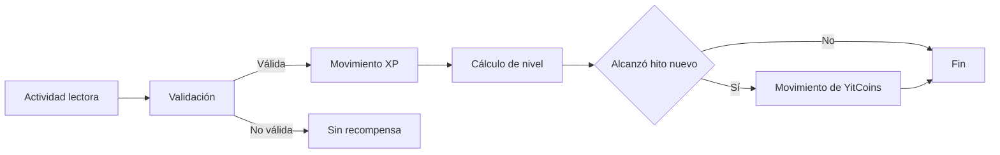

# Sistema XP, niveles y YitCoins — propuesta de reglas v0.1

**Estado:** mecanismo deseado confirmado; fórmulas, tasas, hitos y canjes **no aprobados**.

## 1. Diferenciar XP, nivel y YitCoins

| Elemento | Propósito | Naturaleza |
|---|---|---|
| XP | Evidencia acumulada de actividades de lectura válidas | Puntos de progresión, no dinero |
| Nivel | Tramo alcanzado de experiencia | Derivado de XP y tabla de umbrales |
| YitCoins | Créditos de recompensa de la plataforma | Saldo de uso interno para canjes elegibles |

**Acuerdo del usuario:** obtener XP por lectura, subir niveles y ganar YitCoins en ciertos hitos. «Cada 10 niveles» es un **ejemplo de hito**, pendiente de decisión final. YitCoins pueden utilizarse para adquirir mercancía propia y ediciones físicas elegibles. No están definidos equivalencia monetaria, convertibilidad, caducidad ni restricciones.

## 2. Flujo de progresión

## 3. Reglas deseadas
- Para tener XP persistente debe existir cuenta de usuario.
- La experiencia se obtiene por actividad de lectura que cumpla condiciones verificables y comunicadas.
- Cambiar de nivel depende de umbrales configurables.
- Un mismo hito de recompensa debe acreditarse **una sola vez por usuario**.
- La billetera YitCoins se calcula a partir de movimientos registrados, no de un campo alterable desde el navegador.
- Un canje debe comprobar saldo suficiente y elegibilidad del producto, y registrar débito de manera transaccional.
- La concesión y la reversión de XP/YitCoins requieren trazabilidad y motivo.

## 4. Antifraude — diseño necesario
- No otorgar XP por cada clic o desplazamiento de página.
- Definir qué constituye una lectura válida: contenido autorizado, progreso y eventos consistentes, controles contra repetición abusiva.
- Evitar registrar XP por recargar capítulo, abrir varias pestañas o enviar la misma solicitud repetidas veces.
- Usar identificadores de evento/idempotencia y controles del backend; el cliente nunca calcula ni acredita XP o YitCoins finales.
- Prevenir doble canje con transacciones de base de datos y comprobaciones de inventario.
- Definir límites de emisión y revisión de abuso sin vigilancia excesiva ni colección invasiva de hábitos.

## 5. Ejemplo narrativo, NO una regla económica aprobada
1. Usuario con cuenta termina una lectura autorizada.
2. El backend valida si el evento es elegible y si ya fue premiado.
3. Registra una única asignación de XP.
4. Recalcula el nivel desde la tabla configurada.
5. Si cruza por primera vez un hito de recompensa, genera un abono de YitCoins.
6. En la tienda ve un accesorio marcado como canjeable; si el saldo alcanza, inicia el canje y se registra el débito.

No se asigna cantidad de XP, YitCoins por hito, conversión a dinero ni precio del artículo hasta realizar un diseño balanceado.

## 6. Decisiones abiertas obligatorias

| Clave | Decisión | Estado |
|---|---|---|
| G-01 | XP por capítulo, lectura completada, tiempo u otra métrica | Pendiente |
| G-02 | Verificación de lectura y prevención de abuso | Pendiente |
| G-03 | XP por evento y límites por día/obra | Pendiente |
| G-04 | Curva de niveles: lineal, creciente o tabla manual | Pendiente |
| G-05 | Cada cuántos niveles se entregan YitCoins | Pendiente (ejemplo: 10) |
| G-06 | Cantidad de monedas por hito y presupuesto económico | Pendiente |
| G-07 | Solo canje total o también pago mixto | Pendiente |
| G-08 | Artículos elegibles y stock reservado en canjes | Pendiente |
| G-09 | Política de devoluciones, contracargos y reversión | Pendiente |
| G-10 | Transferencia, vencimiento, compra de YitCoins, convertibilidad | Pendiente |
| G-11 | Política de edad y transparencia del programa de recompensas | Pendiente |

## 7. Riesgos
- XP fácil de manipular → inflación y dificultad para equilibrar recompensas.
- Recompensas costosas → canjes financieramente inviables.
- Doble emisión o doble consumo → pérdidas y saldos incorrectos.
- Recompensa basada en tiempo medido de forma invasiva → afecta privacidad y confianza.
- Lectura de obras sin licencia → riesgo de derechos de autor.

**Recomendación de diseño:** durante el primer prototipo, usar únicamente datos ficticios, contenido propio/de dominio público debidamente verificado, y YitCoins sin valor monetario real. La operación comercial se habilitaría tras aprobar economía, derechos, privacidad y requisitos aplicables.
