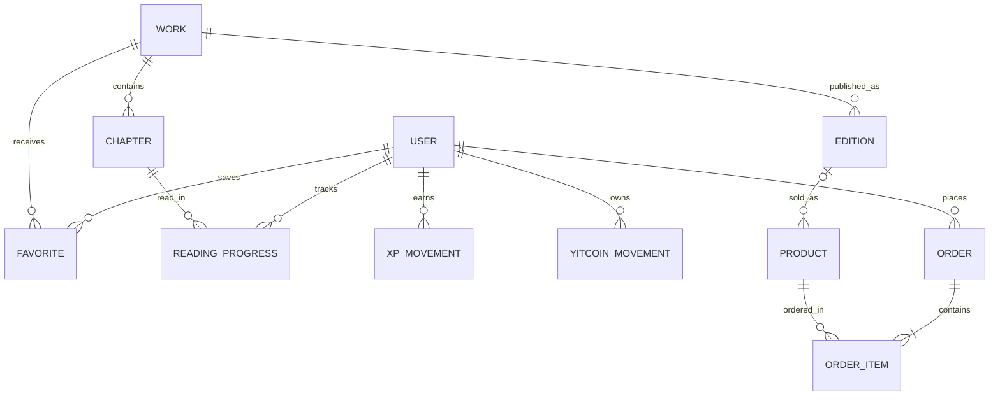

# Modelo conceptual del dominio — v0.1

**Estado:** propuesta de diseño, **NO DDL, NO tablas implementadas**.

## Objetivo
Diferenciar datos editoriales, lectura personal, progresión y comercio sin mezclar conceptos. Las relaciones y nombres definitivos dependen de los RF y HU aprobados.

## Candidatos a entidades y significado

| Concepto | Qué representa | Decisiones pendientes |
| --- | --- | --- |
| Usuario | Cuenta identificada para progreso y compras | Datos, identidad, recuperación |
| Obra | Manga/manhwa u otra obra editorial | Metadatos y fuente legal |
| Capítulo | Unidad legible de una obra | Modelo digital y licencia |
| Edición | Presentación concreta de obra | Digital/física, edición, idioma |
| Producto | SKU comercializable de tienda | Precios, disponibilidad y variantes |
| Favorito | Relación usuario-obra guardada | Favorito vs seguimiento |
| Seguimiento | Relación usuario-obra con estado | Etiquetas/estados posibles |
| ProgresoLectura | Punto de avance de usuario en obra/capítulo | Reglas, dispositivo y marca temporal |
| EventoLectura | Hecho auditable usado para evaluar XP | Datos mínimos, idempotencia |
| MovimientoXP | Aumento o corrección de puntos | Tipos y motivo |
| Nivel | Regla/umbral de XP configurada | Curva aún sin definir |
| RecompensaHito | Concesión única por nivel | Frecuencia y cantidad |
| MovimientoYitCoin | Abono, débito o reversión | Reglas de saldo |
| Pedido | Solicitud comercial | Flujo de pago, estados |
| DetallePedido | Producto/cantidad y costo del pedido | Dinero, YitCoins, mezcla |
| Canje | Redención de créditos por producto | Reserva, reversión, stock |

**No se crean estas entidades en PostgreSQL todavía.** Se usarán para explorar cardinalidades y restricciones.

## Relaciones propuestas

**Nota de precisión:** el diagrama es exploratorio, no impone que todos los capítulos estén disponibles ni que todas las ediciones sean vendibles. Una obra puede tener productos asociados y accesorios pueden no referenciar ninguna obra.

## Decisiones de integridad que deben aprobarse
1. Distinguir una edición física como SKU de una obra o un capítulo.
2. Mantener saldo YitCoins derivable de registros transaccionales.
3. Restringir una recompensa por usuario y hito.
4. Evitar adjudicar XP dos veces por el mismo evento elegible.
5. Mantener stock no negativo si se aprueba inventario de físicos.
6. Evitar que borrar favoritos borre historia de recompensas.
7. Definir manejo de eventos de lectura sobre capítulos que dejan de estar licenciados.
8. No guardar progresos de invitados persistentes sin una política explícita.

## Requisitos antes de la creación de tablas
- Aprobación del flujo comercial y de lectura.
- Definición de tipos y restricciones de datos.
- Revisión de normalización y transacciones.
- Requisitos de privacidad, retención y exportación.
- Identificación de operaciones con concurrencia (XP, canje, inventario, pedidos).

Ver [reglas XP/YitCoins](22-REGLAS-XP-YITCOINS.md) y [funcionalidades](20-VISION-FUNCIONAL-YITVERSE.md).
