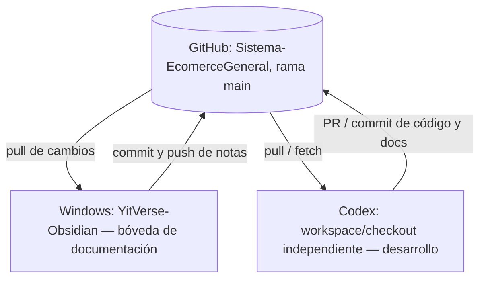

# Configurar sincronización Obsidian ↔ GitHub ↔ Codex

**Estado:** guía y preparación del repositorio completadas. **La sincronización local de Windows aún debe instalarse y probarse físicamente por el usuario.**  
**Fecha de redacción:** 2026-11-03  
**Repositorio:** https://github.com/JoseB-H/Sistema-EcomerceGeneral  
**Sistema objetivo:** Windows con Obsidian Desktop y Git for Windows.

## Diseño elegido — dos copias locales de un mismo repositorio



**Razón:** Obsidian Git puede registrar cambios de todo el repositorio. Por eso, no abrir la misma carpeta de trabajo que Codex esté modificando y ejecutando. Usar una **clonación independiente** para Obsidian, y otra para Codex.

La bóveda académica original de Servicios Cloud (S04–S11 y PDFs) no es parte de este repositorio. No mover ni copiar su contenido aquí sin una revisión de derechos/privacidad.

## Requisitos en Windows

1. **Git for Windows** instalado, versión compatible con Obsidian Git. Verificar desde PowerShell:
   ```powershell
   git --version
   git config --global credential.helper
   ```
   La documentación oficial de Obsidian Git recomienda tener configurado Git Credential Manager. Instalar Git desde https://git-scm.com/download/win si falta.
2. Obsidian Desktop instalado. Descargar desde https://obsidian.md/.
3. Acceso autenticado al repositorio como `JoseB-H`. Git Credential Manager puede abrir el navegador para autenticarte al primer `clone`, `pull` o `push`. **Nunca** pegues contraseñas/tokens en notas o chats.
4. Una carpeta **diferente** al directorio usado por Codex.

## Paso A — crear la copia de Obsidian

En PowerShell puedes usar esta ubicación de ejemplo. Si ya tienes una carpeta para Codex, **no la reutilices**.

```powershell
mkdir D:\Proyectos -ErrorAction SilentlyContinue
cd D:\Proyectos
git clone https://github.com/JoseB-H/Sistema-EcomerceGeneral.git YitVerse-Obsidian
cd .\YitVerse-Obsidian
git remote -v
git branch --show-current
git status
```

Resultado esperado: `origin` apunta al repositorio oficial, la rama es `main` y no hay cambios locales. Si la carpeta `YitVerse-Obsidian` ya existe, **no repitas el clone ni borres archivos**: abre el repositorio existente y verifica primero `git status`.

## Paso B — abrir la bóveda de Obsidian

1. Abre Obsidian Desktop.
2. Selecciona **Open another vault / Abrir otra bóveda** → **Open folder as vault / Abrir carpeta como bóveda**.
3. Selecciona exactamente `D:\Proyectos\YitVerse-Obsidian` (raíz del repositorio, no solo `docs/`).
4. Abre `00 - YitVerse.md` para acceder a los índices, RF/RNF, Sprint 1, decisiones y documentación técnica.

La carpeta `.obsidian/` local está excluida de Git por el `.gitignore` del repositorio, por lo que preferencias y plugins no se publicarán.

## Paso C — instalar y configurar Obsidian Git

1. En Obsidian → **Settings/Ajustes → Community plugins/Complementos de la comunidad → Browse/Explorar**.
2. Busca **Git** (autor: **Vinzent**) e instala y activa el plugin.
3. En **Settings → Git**, configura o habilita:
   - **Pull updates on startup**: activado.
   - **Auto pull interval**: 5 minutos (recomendación, ajustable).
   - **Auto commit-and-sync / Vault backup interval**: 10 minutos (recomendación, ajustable). Debe incluir **pull y push**, no solo commit local.
   - Rama: `main`, `origin` como remoto.
4. En Windows, confirma que Git esté instalado y autenticado; si la sincronización falla, prueba primero `git pull --ff-only origin main` en PowerShell **solo si no tienes cambios locales pendientes**.
5. La primera vez, ejecuta desde la paleta de comandos de Obsidian (`Ctrl+P`) la acción Git de sincronización de commit/pull/push disponible en tu versión del plugin.
6. Revisa las notificaciones/registro del plugin y confirma en GitHub que el commit aparece.

Los nombres exactos de opciones pueden variar por versión del plugin. Ver la documentación oficial: https://publish.obsidian.md/git-doc/Installation y https://publish.obsidian.md/git-doc/Getting%20Started.

## Paso D — prueba segura de ida y vuelta

1. Desde **Obsidian**, crea la nota `docs/solicitudes/PRUEBA-SYNC-OBSIDIAN.md` con solo el texto: `Prueba de sincronización de YitVerse — sin datos personales.`
2. Ejecuta sincronización con Obsidian Git o espera el intervalo configurado.
3. Abre GitHub y comprueba que la nueva nota aparezca en `main`.
4. Desde otra copia de trabajo o por revisión GitHub, modifica **solamente esa nota de prueba** y publica el cambio mediante commit.
5. De vuelta en Obsidian, ejecuta **Pull** (o espera el siguiente intervalo) y confirma que ves el cambio.
6. Una vez comprobado, elimina la nota de prueba desde Obsidian y sincroniza. Los commits anteriores permanecen en el historial público, así que **nunca utilices contenido privado para probar**.

## Precauciones
- **No uses `git init`**: ya es un repositorio clonado con historial y remoto; tampoco crees un segundo repositorio Git en `docs/`.
- No actives auto-commit sobre la misma carpeta donde Codex edita código; podrían registrarse cambios incompletos. La copia separada minimiza ese riesgo.
- No copies los PDFs/diapositivas de clase del vault académico original a este repositorio público.
- `.gitignore` previene **nuevos archivos no rastreados** de ciertas rutas; **no protege** archivos privados que ya fueron versionados o añadidos explícitamente. Revisa `git status` antes de sincronizar.
- Si aparece un conflicto de sincronización, **no uses `git reset --hard`, `push --force` ni borres la carpeta**. Detén la sincronización y revisa los archivos en conflicto.
- Al operar con Codex, preferir **Pull Requests** y cambios de documentación aprobados, no múltiples ediciones del mismo archivo en paralelo.
- La sincronización Git no sincroniza conversaciones de ChatGPT entre sí; comparte archivos y commits.
- El repositorio es público y toda nota publicada puede permanecer en su historial.

## Resultado esperado

- [ ] Git en Windows configurado y autenticado.
- [ ] Clon independiente `YitVerse-Obsidian` creado.
- [ ] Bóveda abierta en Obsidian.
- [ ] Plugin Git instalado y habilitado.
- [ ] Primer push de nota de prueba visible en GitHub.
- [ ] Primer pull de cambio remoto visible en Obsidian.
- [ ] Copia de Codex separada, sin conflictos.

## Contactos / fuente de verdad

- [Documentación general](00-INDICE-DOCUMENTAL.md)
- [Puente Obsidian/Codex](18-PUENTE-CODEX-OBSIDIAN.md)
- [Estado del proyecto](ESTADO-DEL-PROYECTO.md)

**Nunca declarar «sincronizado» hasta comprobar al menos un push y un pull reales desde el equipo del usuario.**
