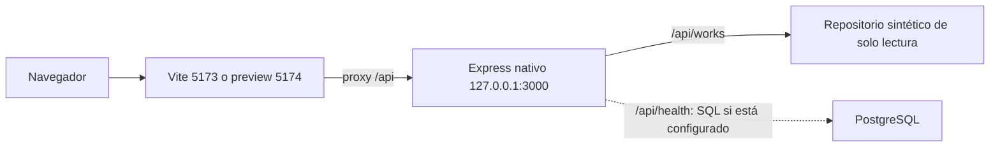

# Entrega Frontend V2 — Incremento5

**Repositorio:** [JoseB-H/Sistema-EcomerceGeneral](https://github.com/JoseB-H/Sistema-EcomerceGeneral). **Rama de entrega:** [`feat/frontend-v2-editorial`](https://github.com/JoseB-H/Sistema-EcomerceGeneral/tree/feat/frontend-v2-editorial). **Último commit funcional:** [`7caff17`](https://github.com/JoseB-H/Sistema-EcomerceGeneral/commit/7caff173a113f319ef3969d6b2c661fe48eddf44), aceptado técnicamente por el usuario.

El Incremento5 consolida y verifica los cuatro anteriores; no añade funciones de producto. Está preparado para revisión de integración, sin PR ni merge. No supone aceptación visual final, cierre del Sprint1 ni aprobación de nuevos módulos.

## 1. Sistema implementado

YitVerse V2 es un prototipo funcional de descubrimiento de seis obras **ficticias**, con Inicio editorial, catálogo buscable y ficha de metadatos. Tema negro profundo/azul eléctrico, arte SVG propio, responsive y estados accesibles. Frontend consume la API real del Backend: no importa una copia de registros ni usa datos de respaldo para aparentar disponibilidad.

Biblioteca personal, lector/capítulos, autenticación, seguimiento, XP, YitCoins, compras y pagos pertenecen a la visión futura; no están implementados ni aparecen como acciones disponibles. No hay contenido editorial de terceros.

## 2. Arquitectura actual



React19.3.1/Vite8.3.5 y Node24/Express5.3.0/pg8.23.1; versiones fijadas con lockfiles, sin dependencias de pago. La navegación reutiliza enlaces nativos, `pathname`, consultas y fragmentos; no se incorporó router externo. `useResource` cancela al desmontar/cambiar consulta, ignora respuestas tardías, limita esperas a4000ms y permite reintento.

Dos compilaciones coexistentes:

- `npm --prefix Frontend run build`: pantalla técnica S01 (`App.jsx`). Artefacto conservado por comparación SHA256.
- `npm --prefix Frontend run build:local`: V2, mediante modo `prototype`; desarrollo también carga V2. Ambos sobrescriben `Frontend/dist`: el último debe ser `build:local` para revisar V2 compilado.

Docker conserva exactamente los servicios `frontend`, `backend`, `database`, dos redes y volumen PostgreSQL; solo Frontend publica loopback, sin puerto DB/Backend al host. Su Dockerfile ejecuta **build normal S01**, y su runtime Backend técnico no monta el catálogo de demostración. La prueba Docker de esta entrega acredita S01/SQL/persistencia, **no un despliegue Docker de V2**. Decidir ese despliegue requiere revisión posterior, sin cambios de arquitectura en este incremento.

## 3. Rutas y navegación

| Ruta | Comportamiento comprobado |
| --- | --- |
| `/` | Hero del primer registro recibido, búsqueda y secciones editoriales |
| `/explorar` | Catálogo completo, búsqueda y formato manga/manhwa |
| `/explorar?q=aurora&format=manga` | Consulta compartible/restaurada al recargar |
| `/?q=…` o `/?format=…` | Compatibilidad con URLs antiguas del catálogo, incluso parámetros vacíos |
| `/obras/:id` | Ficha real del identificador; regreso a Explorar con q/format |
| `/estado` | Diagnóstico técnico; sin PostgreSQL nativo configurado informa indisponibilidad |
| Ruta desconocida |404 de interfaz y regreso al catálogo |
| `/#catalog-query`, `/explorar#catalog-query` | Foco del único campo después del montaje dinámico |

Los filtros aplicados se escriben con `replaceState`, como en el prototipo previo. No se crea una entrada de historial por cada búsqueda; los enlaces y atrás/adelante conservan las URLs aplicadas. Los borradores sin enviar no se presentan como persistencia. La404 de interfaz llega mediante fallback SPA HTTP200 en dev/preview; no se afirma404 HTTP de un servidor de producción.

## 4. Componentes y funcionalidades

| Archivo en `Frontend/src/catalog/` | Responsabilidad |
| --- | --- |
| `CatalogApp.jsx`, `catalog-navigation.js` | Shell, navegación/rutas/enlaces canónicos y compatibilidad |
| `HomePage.jsx`, `Hero.jsx`, `home-sections.js` | Composición desde API:1 destacado,3 para Continuar, restantes para Selección; géneros existentes |
| `CatalogPage.jsx` | Consulta, borrador/filtros aplicados, recuento, tarjetas, vacío/limpiar |
| `WorkDetailPage.jsx` | Título/formato/géneros/sinopsis, aviso ficticio, estados y regreso filtrado |
| `components.jsx` | SearchForm, WorkCard/WorkCover, iconos, carga/error/404 y etiquetas neutrales |
| `catalog-client.js`, `use-resource.js` | HTTP/validación de contratos, cancelación, timeout y reintento |
| `artwork.jsx` | Seis escenas originales, gradientes únicos por instancia, fallback gráfico seguro |
| `tokens.css`, `catalog.css`, `HomePage.css`, `catalog-responsive.css` | Sistema visual acotado al catálogo, estilos y umbrales responsive |

«Continuar explorando» es una sección no personalizada, sin historial. «Selección de demostración» no implica novedades, ranking o popularidad. Los géneros generan búsquedas `q`, sin filtro exacto ni endpoint nuevo. Las seis obras son Archivo Aurora, Órbita de papel, El jardín de los ecos, Ciudad de tinta, Después del último tren y La ruta del viento.

Las portadas siguen3:4 y decorativas (`aria-hidden`); el título/formato/ficción se exponen fuera del SVG. Solo la repetición decorativa del título se limita a tres líneas. Título/sinopsis/géneros extensos conservan su contenido accesible y ajustan líneas. Vacíos válidos usan avisos neutrales; respuestas inválidas no se transforman en otra obra.

## 5. Integración con Backend y Database

- `GET /api/works`: búsqueda insensible a mayúsculas/acentos por título/sinopsis/género y filtro de formato. Respuesta `source.kind=synthetic`, `persisted=false`.
- `GET /api/works/:id`: ficha o404. El cliente valida estructura/fuente/identificador y no muestra errores internos del proveedor.
- `GET /api/health`: disponibilidad real de Backend/PostgreSQL; espera `SELECT 1 AS ok`. En ejecución nativa sin configuración PostgreSQL devuelve503. No se simula éxito.

Datos en `Backend/src/catalog/demo-data.js`, aislados detrás de `demo-repository.js` e inyección en `createApp`. Conectar PostgreSQL al diagnóstico **no convierte el catálogo en persistente**. No hay modelo/migraciones comerciales ni escritura de obras.

Se revalidó y se repitió al cierre Docker/SQL en un clon local limpio e independiente de7caff17, proyecto nuevo `yitverse-s01-v2-inc5-76fe0776`, puerto39179 e identidad/guardas propias.15 pruebas de guardas,10 de integración y1 de persistencia aprobaron, con dos recreaciones PostgreSQL y limpieza de esquemas sintéticos propios. Después se detuvieron solo sus tres contenedores; volumen conservado. El laboratorio anterior mantuvo IDs/estado/redes/volumen. No hubo borrado de volúmenes ni limpieza global. [Evidencia inicial](assets/frontend-v2-inc5/docker-postgresql.json) · [Repetición final](assets/frontend-v2-inc5/docker-verificacion-final.json).

## 6. Pruebas y evidencias definitivas

| Suite/comprobación | Resultado |
| --- | --- |
| Backend |45/45 |
| Frontend |58/58, conservadas íntegramente |
| Guardas Compose |15/15 |
| Integración Docker real S01 |10/10 |
| Persistencia PostgreSQL real |1/1, dos recreaciones |
| Observación de consola (Python estándar) |6/6 regresiones nuevas |
| Total de casos de esas suites |135 aprobados, sin fallos/omitidas |
| Builds normal/local |Ambos salida0; S01 idéntico por SHA256 |
| Chromium |Dos smokes en dev y dos en preview compilado;320/390/768/1440px |
| Funcional |Inicio→Explorar→Ficha→Volver, filtros/acentos/géneros, historial, recargas directas y URLs antiguas |
| Estados/fixtures |Carga/error/vacío/reintento/404, metadatos extensos/vacíos/incompletos y texto literal sin HTML |
| Responsive |Sin desbordes;3:4; controles principales≥44px; resize/rotación simulada conserva filtros |
| Accesibilidad acotada |Teclado/salto al contenido/foco visible, etiquetas, semántica y movimiento reducido |
| Consola |Cero `pageerror` y cero errores/avisos inesperados de aplicación; diagnósticos HTTP esperados separados |
| Dependencias |`npm ls --all`:0 problemas; `npm audit`:0 avisos en ambos proyectos, sin actualizar paquetes |
| Git/publicación |fsck correcto, cuatro incrementos presentes, barrido de archivos/historial sin secretos detectados; push inicial7caff17 confirmado antes de editar |

Los diagnósticos404/503 y `ERR_FAILED` se permiten únicamente para el endpoint/código exactos y mientras el escenario negativo tiene activa su expectativa. Fuera de ese ámbito se registran como inesperados. El404 del favicon predeterminado se registra por separado como recurso de navegador ausente; no se cuenta como error JavaScript ni se extiende esa excepción a otras URLs/estados. `console_checks.py` añade observación de consola a los dos smokes existentes; no cambia producto. La revisión detectó que el filtro inicial de errores de API era demasiado amplio: se reprodujo un503 no previsto clasificado incorrectamente, se corrigió por ámbitos exactos y las seis regresiones pasaron RED→GREEN. Incluyen endpoint/estado fuera de ámbito, expiración ante excepción, anidación, errores/avisos de aplicación y favicon separado. Los fixtures solo se interceptan en contextos de prueba, conservando la API real en la aplicación.

Contrastes de muestras: texto19,02; secundario7,76; botón4,94; campo18,18; borde4,00; foco8,51. Movimiento reducido:0s/none/none/auto. Firefox/WebKit no estaban instalados para el Playwright disponible; se usó Chromium del sistema. No se instalaron motores adicionales ni se atribuye compatibilidad no probada.

Capturas recién generadas por los smokes. Se compararon SHA256 con las anteriores: seis se reutilizan por identidad exacta y seis se guardan nuevas; no se duplican PNG idénticos. [Manifiesto de las12 capturas](assets/frontend-v2-inc5/capturas-definitivas.json). La tabla siguiente enlaza las vistas definitivas; las comparativas históricas siguen en [Inc2](FRONTEND-V2-INCREMENTO-2-PRUEBAS.md)/[Inc3](FRONTEND-V2-INCREMENTO-3-PRUEBAS.md)/[Inc4](FRONTEND-V2-INCREMENTO-4-PRUEBAS.md).

| Vista definitiva | Captura |
| --- | --- |
| inicio-escritorio | [Ver](assets/frontend-v2-inc5/inicio-escritorio.png) |
| inicio-movil | [Ver](assets/frontend-v2-inc4/despues/inicio-mobile.png) |
| explorar-escritorio | [Ver](assets/frontend-v2-inc5/explorar-escritorio.png) |
| explorar-movil | [Ver](assets/frontend-v2-inc5/explorar-movil.png) |
| busqueda-filtros | [Ver](assets/frontend-v2-inc5/busqueda-filtros.png) |
| busqueda-filtros-movil | [Ver](assets/frontend-v2-inc4/despues/filtros-mobile.png) |
| ficha-escritorio | [Ver](assets/frontend-v2-inc4/despues/ficha-desktop.png) |
| ficha-movil | [Ver](assets/frontend-v2-inc4/despues/ficha-mobile.png) |
| seis-ilustraciones | [Ver](assets/frontend-v2-inc4/despues/seis-ilustraciones.png) |
| error | [Ver](assets/frontend-v2-inc5/error.png) |
| vacio | [Ver](assets/frontend-v2-inc5/vacio.png) |
| navegacion-movil | [Ver](assets/frontend-v2-inc3/navegacion-mobile.png) |

[Auditoría previa a publicación](assets/frontend-v2-inc5/auditoria-publicacion.json). Resultados finales [suites/builds](assets/frontend-v2-inc5/verificacion-final.json). Mediciones: catálogo [dev](assets/frontend-v2-inc5/catalogo-dev.json)/[preview](assets/frontend-v2-inc5/catalogo-preview.json); ficha [dev](assets/frontend-v2-inc5/detalle-dev.json)/[preview](assets/frontend-v2-inc5/detalle-preview.json). Los logs locales completos se conservan en el laboratorio; el repositorio incluye resúmenes sin credenciales.

Archivos del Incremento5: documento33, cinco notas de continuidad/guía/estado/alineación, README, índice/centro Obsidian, guías local/recuperación y plan; dos smokes, helper `console_checks.py` y sus seis pruebas; manifiestos/métricas y seis PNG nuevos. `.gitignore` excluye bytecode Python generado por estas herramientas. No cambian componentes de producto ni contratos/servicios/dependencias.

Prueba de la instrumentación: `python3 Frontend/test/browser/console_checks_test.py`.

## 7. Limitaciones y riesgos de integración

- El navegador puede pedir `/favicon.ico` y recibir404: recurso predeterminado ausente, registrado en `expected_browser_errors`, sin afectar rutas ni contenido. Mejora menor pendiente; no se afirma una consola global sin diagnósticos de red.
- Windows, dispositivos físicos, Safari/Firefox, lectores de pantalla y auditoría WCAG integral no verificados. Las pruebas Chromium Linux/resize no equivalen a ello.
- Catálogo sintético de solo lectura, sin persistencia de obras. PostgreSQL nativo del equipo del usuario sigue sin comprobación; el éxito SQL de esta entrega pertenece al laboratorio Docker aislado.
- No despliegue V2 en Docker/producción; el flujo Docker predeterminado conserva S01. Preview acredita compilación/proxy/fallback locales.
- Una petición API de detalle con codificación porcentual inválida puede devolver503 saneado en lugar de400, antecedente Backend fuera del alcance V2; no afecta las URLs válidas verificadas.
- `main` observado en `ae3f8e8`; ancestro común `b32ee01`. Main y esta rama añaden las mismas notas00/31 desde ese ancestro: una futura integración puede producir conflictos add/add documentales. Además, comparar esta rama con main incluye S01 y catálogo heredados, no solo estilos V2. Coordinar la revisión con PR#3; no se ha fusionado ni modificado.
- El barrido previo de secretos cubrió nombres, textos, nuevos blobs y muestra visual de capturas; no es garantía absoluta. Se excluyen `.env`, dependencias, dist, dumps y bundles del repositorio público.

## 8. Estado real de Figma

[Archivo de referencia](https://www.figma.com/design/dCLgExm48T9Ui6sTcEIhwu). No se acreditaron mockups terminados/aprobados. El trabajo sigue la especificación Markdown provisional y autorizaciones por incremento. La aceptación técnica de1–4 no prueba aprobación artística final o contenido de Figma.

## 9. Historial de los cinco incrementos

| Incremento | Commit | Resultado |
| --- | --- | --- |
|1 Continuidad |`daf3c85` |Rama desde127aa8a, incorporación selectiva de notas main y recuperación segura |
|2 Sistema visual |`fba88e3` |Tokens/componentes/tema negro y azul, guía32 y comparativas |
|3 Inicio/Explorar |`ddf908e` |Rutas separadas, Home desde API y compatibilidad/historial |
|4 Arte/ficha/móvil |`7caff17` |Refinamiento de seis SVG, ficha editorial, vacíos y móvil |
|5 Verificación/entrega |Commit que incorpora esta nota |Consolidación, consola, verificación integral, documentación y publicación autorizada |

Commit documental de cierre: `docs(frontend): consolidate V2 verification and delivery`. Su SHA exacto queda en el manifiesto del bundle y en la entrega; desde cualquier clon se obtiene con:

```bash
git log -1 --format="%H %s" -- docs/33-ENTREGA-FRONTEND-V2.md
git rev-parse HEAD
```

No se inventa un SHA autorreferente dentro del archivo que lo produciría. El respaldo remoto inicial fue7caff17; el cierre se publica únicamente en la misma rama después de revalidar su estado. No se autoriza PR/merge/main.

## 10. Retomar desde otro entorno y Obsidian

Primero leer `AGENTS.md`, esta entrega, [bitácora](00-BITACORA-DE-CONTINUIDAD.md), [especificación31](31-YITVERSE-DISENO-VISUAL-V2.md), [guía32](32-GUIA-VISUAL-FRONTEND-V2.md), [estado](ESTADO-DEL-PROYECTO.md) y [alineación](ALINEACION-ENTRE-CHATS.md). El repositorio/esta rama son la fuente versionada compartida; los chats no se sincronizan automáticamente.

La rama V2 **ya está publicada**, a diferencia de los informes históricos1–4. Usar un clon nuevo. Conservar intactos el repositorio original de Windows y su respaldo; no ejecutar estas instrucciones dentro de ellos. [Procedimiento completo de recuperación](RECUPERACION-GIT-WINDOWS.md).

PowerShell, ejemplo de destino nuevo que debe estar libre:

```powershell
$destinoV2 = 'D:\Proyectos\YitVerse\YitVerse-Frontend-V2-Limpio'
if (Test-Path -LiteralPath $destinoV2) { throw 'Elegir otra carpeta nueva; no sobrescribir.' }
git clone --single-branch --branch feat/frontend-v2-editorial https://github.com/JoseB-H/Sistema-EcomerceGeneral.git $destinoV2
if ($LASTEXITCODE -ne 0) { throw 'Falló la clonación; conservar diagnóstico.' }
Set-Location -LiteralPath $destinoV2 -ErrorAction Stop
git fsck --full
if ($LASTEXITCODE -ne 0) { throw 'Integridad incorrecta; no reparar ni borrar objetos.' }
git status --short --branch
git log -5 --oneline
```

Con Node24/npm, dos terminales propias desde esa copia:

```powershell
# Terminal1
npm --prefix Backend ci
npm --prefix Backend run dev
# Terminal2
npm --prefix Frontend ci
npm --prefix Frontend run dev
```

Abrir http://localhost:5173. Si PowerShell bloquea npm.ps1, usar npm.cmd sin cambiar la política global. No hace falta crear `.env` para el catálogo; no copiar el `.env` Docker a Backend. Para preview, ejecutar ambos builds en orden normal→local, mantener Express activo y desde Frontend usar `npm exec vite -- preview --host localhost --port 5174 --strictPort`. [Guía local detallada](LOCAL-DEV-CATALOGO.md).

Para actualizar **una copia limpia ya verificada de esta rama**, comprobar status/rama antes de `git pull --ff-only origin feat/frontend-v2-editorial`. Si hay cambios propios o divergencia, detenerse y conservarlos; no limpiar, forzar ni reemplazar respaldos.

Obsidian: abrir la **raíz de un clon documental separado** como bóveda, comenzar por [00 - YitVerse](../00%20-%20YitVerse.md) o esta nota; así también resuelven enlaces hacia README/AGENTS y las capturas. `.obsidian` es local/ignorado. Un pull de Git recupera notas/arte versionados; habilitar Obsidian Git es opcional y debe verificarse en Windows. No se afirma que la aplicación ya esté sincronizada ni se copia la bóveda académica privada.

Mensaje útil para un nuevo chat: «Continúa YitVerse en JoseB-H/Sistema-EcomerceGeneral, rama feat/frontend-v2-editorial. Lee AGENTS.md y docs/33-ENTREGA-FRONTEND-V2.md antes de actuar. Inc5 es verificación/entrega; no hay autorización para nuevas funciones, PR o merge».

Los cuatro bundles anteriores permanecen conservados. Tras el commit de cierre se genera otro bundle en un destino nuevo, verificado mediante `git bundle verify`, clonación real, fsck y comparación de todos los archivos versionados. El manifiesto externo registra SHA/commit/ruta y confirmación del push final. Un bundle respalda código/historial, no credenciales ni datos PostgreSQL. Las rutas/huellas finales se entregan al usuario; no se guardan secretos ni bundles en GitHub.

## 11. Próximas etapas recomendadas — sin autorización de ejecución

1. Revisar esta entrega y aceptar visual/funcionalmente V2. Comprobar el arranque en una nueva copia Windows y el flujo documental Obsidian.
2. Autorizar después una revisión/PR de integración coordinada con S01/PR#3 y catálogo. Resolver las notas add/add con revisión humana y decidir cómo desplegar V2; no asumir que el build Docker actual ya la sirve.
3. Refinar Figma y el siguiente alcance del producto con RF/HU/licencias/criterios aprobados antes de programar persistencia comercial, cuentas, biblioteca o lectura.

**Punto de parada:** Incremento5 entregado para revisión; no se inicia otra funcionalidad ni se abre PR o fusiona main por inferencia.
