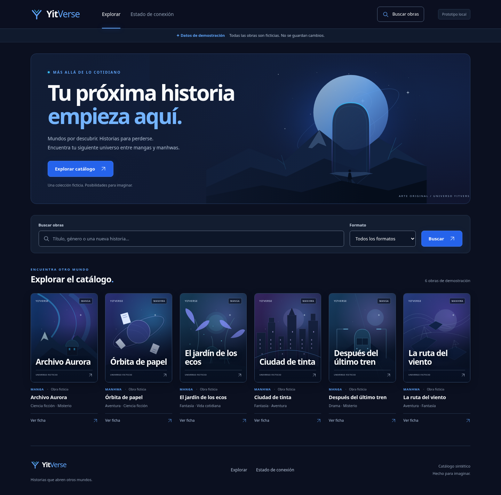
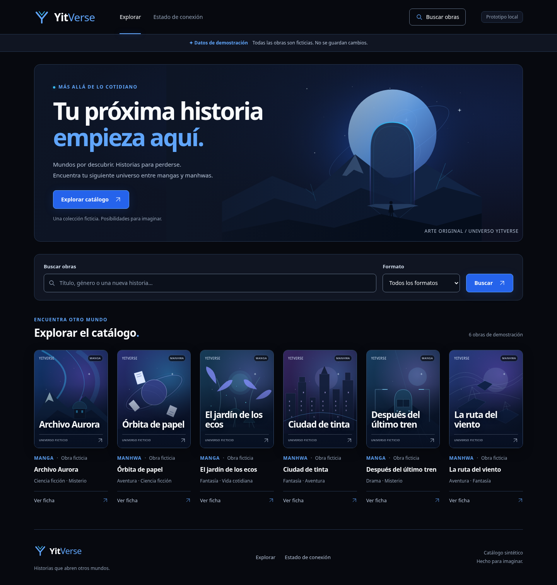

# Incremento2 — pruebas y comparativas del sistema visual V2

**Fecha:** 2026-11-05 (America/Bogota). **Rama:** `feat/frontend-v2-editorial`, únicamente local. **Base:** `daf3c85`. Solo sistema visual; Incremento3, push y PR no autorizados. [Guía visual](32-GUIA-VISUAL-FRONTEND-V2.md).

## Recuperabilidad y alcance

Antes de editar se comprobó árbol limpio y presencia de `daf3c85`. Se creó `/workspace/YitVerse-Resguardos/inc2-daf3c85-uw8d8kkb/yitverse-daf3c85.bundle` fuera del repositorio, con SHA256 `7063a922c5cc93acce2c9b0202653621466393a38760ae352d669a76be31799a`. `git bundle verify` terminó correctamente y una clonación real desde ese bundle recuperó `daf3c855001baa400961e35f8f9de1ff7d16eea0` y sus documentos; `git fsck --full` no detectó corrupción. Un aviso de commit desconectado es informativo, sin borrar objetos. Se conservará el bundle inicial y se entregará otro del commit final.

No se accedió a D: ni se alteraron respaldos Windows. El bundle contiene trabajo versionado; no incorpora `.env`, `node_modules`, compilados ni modificaciones locales de Windows. Estos artefactos cloud no acreditan el respaldo del equipo del usuario y conviene conservar una copia fuera de esta sesión.

Aplicación: tres hojas CSS locales (tokens/base/responsive), más dos imports CSS en `CatalogApp.jsx`. Contratos/API, handlers/rutas, datos y seis SVG originales permanecen idénticos a `daf3c85`. No hay dependencias nuevas ni cambios Backend/Database/Docker.

## Verificaciones ejecutadas

| Comando / escenario | Resultado real |
| --- | --- |
| `npm --prefix Backend test` | **45/45**, 0 fallos/omitidas |
| `npm --prefix Frontend test` | **35/35**, 0 fallos |
| `npm --prefix Frontend run build` | Salida0; todos sus archivos y huellas SHA256 idénticos al build previo de S01 |
| `npm --prefix Frontend run build:local` | Salida0; incluye los estilos V2 locales |
| Chromium1440×1000,768×1024,390×844,320×800 | Sin desbordamiento; portadas0,75; controles de cabecera≥44px |
| Legibilidad y campos | Información normal≥12px; campos≥44px y contenido tipográfico cabe verticalmente; «Todos los formatos» cabe completo |
| Teclado | Skiplink, acceso al campo desde header/hero/ficha, foco sin quedar bajo header y foco conservado al buscar |
| Integración real | Seis registros por API; búsqueda ÓRBITA/formato, ficha, atrás/adelante/regreso filtrado aprobados |
| Estados | Carga, red interrumpida y reintento, vacío/limpiar, obra/página desconocida y salud503 reales aprobados |
| Recursos | 21 IDs de gradiente únicos, sin imágenes externas ni peticiones a terceros; cero errores JS |
| Movimiento reducido | Transición0s, animaciónnone, transformaciónhovernone, scrollauto |

Las pruebas de navegador usan `python3 Frontend/test/browser/dark-catalog-smoke.py --output RUTA_DE_CAPTURAS`, con Express/Vite nativos propios activos en3000/5173. Se ejecutó antes y después del cambio. Python/Playwright1.62.0/Chromium ya estaban disponibles; no son nuevas dependencias obligatorias de la aplicación.

Regresión observada antes del cambio: metadatos de tarjetas a8,96px y etiquetas/notas por debajo de12px. La nueva comprobación de legibilidad falló antes de aplicar tokens y pasó después. Se añadió comprobación de espacio vertical de campos; Chromium devuelve `line-height: normal` en el select nativo, por lo que el test usa métricas de fuente del canvas en ese caso, sin inventar una línea numérica.

La comprobación de superficie de `/estado` usa el token semántico `--surface`, en lugar del color literal del tema anterior. Preserva la verificación de aislamiento de salud y todos los escenarios previos.

## Contraste medido antes y después

| Combinación real | Antes | Después |
| --- | --- | --- |
| Texto principal / fondo | 18,10:1 | 19,02:1 |
| Metadatos / fondo | 7,38:1 | 7,76:1 |
| Texto / botón azul | 4,94:1 | 4,94:1 |
| Texto / campo | 17,27:1 | 18,18:1 |
| Borde de control / campo | 3,80:1 | 4,00:1 |
| Foco / superficie | 7,87:1 | 8,51:1 |

Son pares de estilos computados, no medición de todos los píxeles del arte ni certificación WCAG completa. [Mediciones anteriores](assets/frontend-v2-inc2/mediciones-antes.json) y [posteriores](assets/frontend-v2-inc2/mediciones-despues.json).

## Capturas comparativas sin edición

Mismos servidores nativos, datos, rutas y anchuras. Las imágenes originales se copiaron sin procesamiento ni composición externa. Cada enlace permite revisar la captura completa.

| Vista | Antes (`daf3c85`) | Después (Incremento2) |
| --- | --- | --- |
| Catálogo1440px | [Abrir](assets/frontend-v2-inc2/catalogo-desktop-antes.png) | [Abrir](assets/frontend-v2-inc2/catalogo-desktop-despues.png) |
| Catálogo390px | [Abrir](assets/frontend-v2-inc2/catalogo-mobile-antes.png) | [Abrir](assets/frontend-v2-inc2/catalogo-mobile-despues.png) |
| Ficha1440px | [Abrir](assets/frontend-v2-inc2/ficha-desktop-antes.png) | [Abrir](assets/frontend-v2-inc2/ficha-desktop-despues.png) |
| Ficha390px | [Abrir](assets/frontend-v2-inc2/ficha-mobile-antes.png) | [Abrir](assets/frontend-v2-inc2/ficha-mobile-despues.png) |
| Conexión320px | [Abrir](assets/frontend-v2-inc2/estado-conexion-320-antes.png) | [Abrir](assets/frontend-v2-inc2/estado-conexion-320-despues.png) |
| Error1440px | [Abrir](assets/frontend-v2-inc2/estado-error-desktop-antes.png) | [Abrir](assets/frontend-v2-inc2/estado-error-desktop-despues.png) |

Comparación del catálogo en escritorio:

| Antes | Después |
| --- | --- |
|  |  |

## Límites y siguiente paso

Sin pruebas Windows/lector de pantalla/PG nativo/Docker en este incremento. El objetivo AA se apoya en contraste, etiquetas, teclado, foco y reduced-motion comprobados; no equivale a aceptación visual humana. Figma sigue pendiente. La fuente del catálogo continúa sintética, sin persistencia ni nuevas reglas de negocio.

No se crean Inicio/Explorar separados, ni se avanza al Incremento3. Se entrega commit local para revisión; no se hace push ni se abre PR.

## Revisión independiente final

Revisión del diff completo desde `daf3c85`, CSS nuevo, guía/reporte y las12capturas: sin hallazgos críticos, importantes o menores accionables. El revisor comprobó además desbordamiento en16anchuras entre320y1440px, a ambos lados de los umbrales; no detectó problemas. Las suites/builds citadas son evidencia del autor, no una repetición independiente.

El revisor no certifica Windows, lectores de pantalla, Safari/Firefox, conformidad WCAG completa, operación PostgreSQL/Docker, aprobación Figma, funciones comerciales ni incrementos futuros. Se mantienen expresamente fuera de las garantías de esta entrega: el objetivo AA tiene comprobaciones acotadas y la revisión humana sigue pendiente. No se cambia el alcance para intentar acreditar esos puntos.
