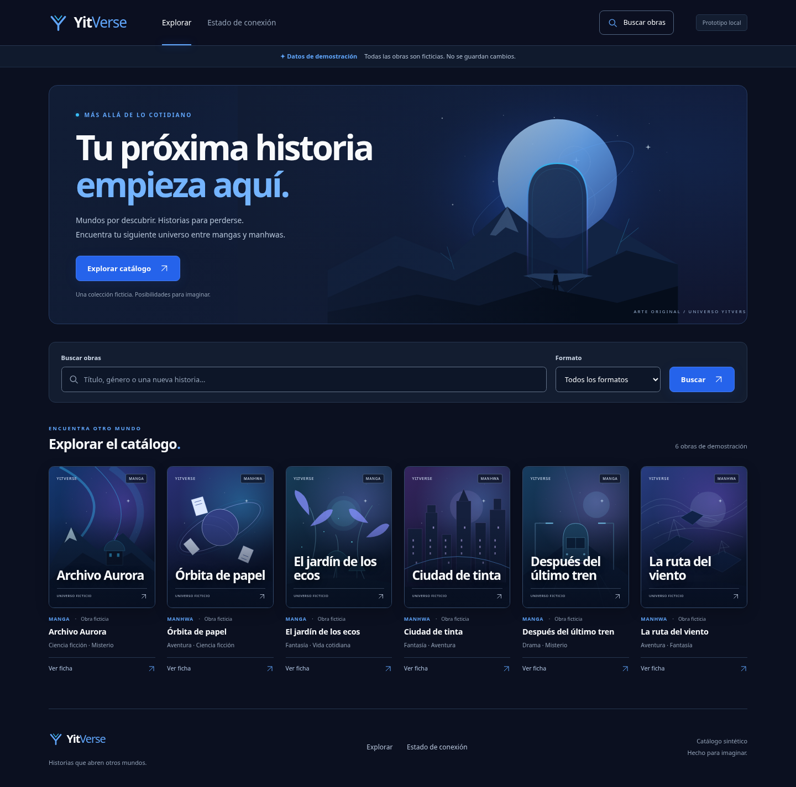
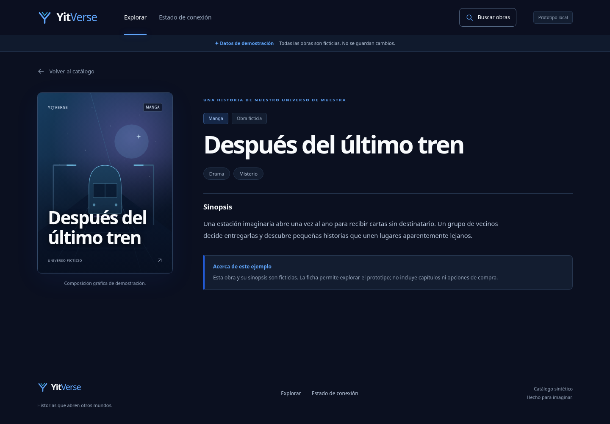
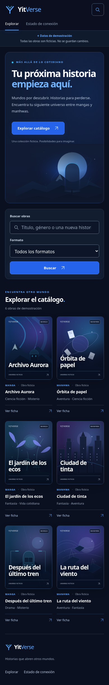

# YitVerse — rediseño azul nocturno

**Fecha:** 2026-11-04 (America/Bogota). **Rama:** `feat/ui-azul-nocturno`. **Base:** `feat/local-dev-catalogo`, `4794803`. Revisión y aceptación visual del usuario pendientes. [Diseño](superpowers/specs/2026-11-04-ui-azul-nocturno-design.md), [plan](superpowers/plans/2026-11-04-ui-azul-nocturno.md), [ejecución en Windows](LOCAL-DEV-CATALOGO.md).

## Cambios

La identidad verde/clara provisional se sustituye por una biblioteca editorial nocturna: fondo `#0B1020`, superficie `#131D30`, azul principal `#2563EB`, acentos `#38BDF8`, `#60A5FA` y `#8B5CF6`, texto `#F8FAFC`/`#94A3B8` y bordes decorativos `#26364F`. Se añade profundidad con iluminación, gradientes y sombras discretas.

- Header con símbolo YitVerse propio, navegación visible y acceso accesible al único buscador real. Desde catálogo conserva filtros; desde ficha navega a `/#catalog-query` y enfoca el campo después del montaje de React.
- Hero original con paisaje nocturno, portal y mensaje sobre descubrir historias. Su acción lleva al buscador, sin simular lectura u otras funciones.
- Seis portadas verticales 3:4, con escenas SVG originales: observatorio/aurora, órbita de papel, jardín, ciudad, tren y viento. Los títulos, formatos, géneros y sinopsis originales no cambian. Los SVG son decorativos y sus gradientes tienen IDs únicos por instancia.
- Ficha con portada ampliada y jerarquía de sinopsis/géneros/regreso; carga, vacío, error, reintento y 404 comparten el tema. `/estado` también es oscuro en el prototipo local.
- Footer con identidad y enlaces reales. Rejilla de seis columnas en escritorio amplio, tres en tablet, dos en móvil y una bajo 360px. Transiciones moderadas sin animación continua; movimiento reducido desactiva transiciones y desplazamientos.

La consulta a `https://olympusxyz.com/` falló con `curl: (56) CONNECT tunnel failed, response 403` (`HTTP/1.1 403 Forbidden`). No se alteró la política de red ni se acreditó inspección visual del sitio. Se tomó la organización descrita por el usuario como inspiración; ningún código, logo, texto ni activo de Olympus fue importado.

## Capturas de Chromium — datos ficticios

Escritorio 1440px:



Ficha de escritorio:



Móvil 390px:



Las capturas corresponden a servidores nativos en Linux cloud. No representan ejecución en Windows ni uso de contenido editorial real.

## Pruebas ejecutadas

| Comando / comprobación | Resultado observado |
| --- | --- |
| `npm --prefix Backend test` | **45/45** aprobadas; cero fallos/omitidas |
| `npm --prefix Frontend test` | **35/35** aprobadas; 31 originales + 4 nuevas de accesos/foco; cero fallos |
| `npm --prefix Frontend run build` | Salida 0; pantalla técnica S01 conservada |
| `npm --prefix Frontend run build:local` | Salida 0; prototipo oscuro construido |
| Chromium 1440×1000, 768×1024, 390×844 y 320×800 | Sin desbordamiento; portadas con ratio medido 0,75; controles principales de header al menos 44×44px |
| Teclado | Skiplink, acceso a buscador desde hero/header/ficha y foco estable tras buscar aprobados |
| API real por proxy Vite | Seis IDs esperados, `synthetic/persisted:false`; salud 503 real sin PostgreSQL |
| Flujo | Búsqueda `ÓRBITA` + manhwa, URL codificada, ficha directa, atrás/adelante y vuelta con filtros aprobados |
| Estados | Carga con petición retenida; fallo de red controlado y recuperación con Reintentar; vacío/limpiar, obra/página desconocida y diagnóstico503 aprobados |
| Recursos y ejecución | 21 IDs de gradiente distintos; cero imágenes SVG externas, peticiones a terceros y errores JavaScript |
| Movimiento reducido | Estilos computados: transición `0s`, animación `none`, transformación hover `none`, desplazamiento `auto` |

Contrastes calculados a partir de estilos reales en Chromium: texto principal/fondo **18,10:1**, secundario/fondo **7,38:1**, botón primario **4,94:1**, texto/campo **17,27:1**, borde/campo **3,80:1** y foco/superficie **7,87:1**. El borde decorativo solicitado no se usa como único límite visual de los campos. Estas mediciones acotadas no constituyen certificación WCAG completa ni análisis de cada píxel de las ilustraciones decorativas.

TDD y depuración: tres pruebas nuevas fallaron antes de implementar los accesos. Chromium detectó un ancho táctil de 38,59px en tablet; se corrigió mediante `min-width:44px`. También descubrió que el fragmento desde otra página llegaba antes de la importación dinámica de React: se añadió una regresión que falló antes de enfocar el campo en el montaje. Resultado final 35/35 y flujo real aprobado. El test de teclado espera a que React esté montado, y la interrupción de red resuelve las peticiones retenidas del modo estricto de desarrollo.

## Repetición local

Se conservan Node.js 24, scripts y puertos de la [guía Windows](LOCAL-DEV-CATALOGO.md): Express en `127.0.0.1:3000` y Vite en `localhost:5173`. No hay nuevas dependencias de ejecución ni cambios de lockfiles. La alternativa Backend sin watch documentada anteriormente se utilizó en cloud; no se atribuye al rediseño una corrección del observador Node.

La comprobación visual versionada es opcional: requiere Python y Playwright, independientes de la ejecución del prototipo. En cloud se utilizó Playwright 1.62.0. Para preparar **opcionalmente** esa prueba en Windows con Python ya instalado, usar `python -m pip install playwright==1.62.0` y `python -m playwright install chromium`. Con los dos servidores activos y Chromium disponible:

```powershell
python Frontend/test/browser/dark-catalog-smoke.py
# Para seleccionar otro ejecutable Chromium instalado:
# python Frontend/test/browser/dark-catalog-smoke.py --chromium-path 'RUTA_REAL_A_CHROMIUM'
```

El script usa el Chromium del PATH cuando existe; de lo contrario, el instalado por Playwright. Guarda capturas locales en `.local/ui-azul` y muestra un resumen JSON. La prueba debe ejecutarse sobre un entorno local aislado con estos seis datos sintéticos y sin PostgreSQL configurado; falla si la salud deja de ser 503. No llama Docker ni escribe datos de negocio. Playwright se encontraba disponible en el entorno cloud; no es una nueva dependencia obligatoria del proyecto.

## Conservación y límites

Se mantiene intacto Backend, sus seis registros y API, Database, Docker/Compose/scripts S01, cliente/hook de catálogo, configuración Vite, `App.jsx`/`App.css` técnicos y todos los manifiestos/lockfiles. El CSS oscuro de `/estado` queda dentro de `.catalog-shell`; no cambia el estilo del build S01. No se implementan rankings, puntuaciones, capítulos, lectura, cuenta, XP, monedas, compra o pago. No se copian recursos externos ni se añade un selector de tema que no fue solicitado.

Windows/D:, PostgreSQL nativo, persistencia de obras, comparación visual directa con Olympus y auditoría WCAG completa: **NO VERIFICADOS**. Las pruebas Docker no se ejecutaron en esta tarea; se conserva su evidencia S01. El pendiente anterior de ID con codificación porcentual malformada (503 saneado en vez de 400) pertenece al Backend sin cambios y no se altera en este rediseño.

La rama se entrega para revisión; no se fusiona `main`, no se modifica el PR #3 y no se declara aceptado el sprint.

## Revisión final y decisiones de entrega

Revisión independiente de la rama completa y documentación/capturas: sin hallazgos críticos ni importantes. Confirmó de nuevo en Chromium el foco desde ficha al único buscador y la superficie oscura local de `/estado`. Detectó como menor el recorte de “Todos los formatos” en tablet; se corrigió dentro del alcance de legibilidad solicitado. Una regresión Chromium midió 114,60px de texto frente a 95px disponibles antes del cambio; con columna de 170px pasó a 120px disponibles. Después pasaron todo Chromium, 45 Backend, 35 Frontend y ambos builds. No quedaron hallazgos nuevos pendientes del rediseño.

El primer revisor solicitado no pudo iniciar por límite de uso del servicio; se utilizó otro revisor independiente disponible, sin adquirir servicios ni créditos. Las suites/builds son evidencia del autor, no una repetición independiente; el revisor comprobó fuente, documentación y escenarios reales de Chromium. No se solicitó otra revisión tras la corrección: la regresión y suites verdes verifican el cambio.

Decisiones del implementador: seguir la autorización explícita de preparar/implementar/publicar sin un nuevo gate intermedio (la estética sigue sujeta a revisión); usar el checkout cloud limpio con registro manual de tareas (Windows/D: y helpers empaquetados no disponibles); usar solo la organización descrita de Olympus ante 403 (sin comparación directa); sustituir el revisor indisponible por uno disponible (capacidad del modelo limitada por el servicio); corregir el detalle menor de tablet por el criterio explícito de filtros legibles (ajuste CSS acotado, sin cambios de API). Los límites apartados por el revisor — Windows/D:, PostgreSQL/persistencia, WCAG completo, comparación Olympus y aceptación visual humana — siguen pendientes: no se transforman en garantías por publicar la rama.

Comprobación del diff: Backend/Database/Docker/scripts S01, cliente/hooks, `App.jsx`/`App.css`, Vite y manifiestos/lockfiles se mantienen idénticos a `4794803`. No se publican `.env`, dependencias ni compilados. GitHub se comprueba por referencias; se publica únicamente la rama del rediseño.
