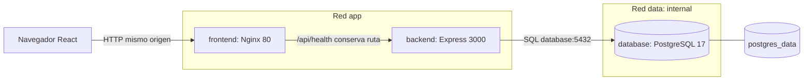

# Sprint 1 de YitVerse — Infraestructura Implementation Plan

> **For agentic workers:** REQUIRED SUB-SKILL: Use superpowers:subagent-driven-development (recommended) or superpowers:executing-plans to implement this plan task-by-task. Steps use checkbox (`- [ ]`) syntax for tracking.

**Goal:** Demostrar la construcción, comunicación, manejo de fallos y persistencia de tres servicios mediante Docker Compose, correspondientes a HU-T01, HU-T02 y HU-T03.

**Architecture:** React se compila con Vite y se sirve con Nginx en `frontend`, que también reenvía `/api/` a Express en `backend`. Backend consulta PostgreSQL en `database`; dos redes separan HTTP y datos, y un volumen nombrado conserva PostgreSQL al recrear su contenedor.

**Tech Stack:** JavaScript ESM, React, Vite, Nginx, Node.js 24 LTS, Express 5, `pg`, PostgreSQL 17, Docker Compose v2; `node:test`, Supertest, Vitest, jsdom y React Testing Library para pruebas.

**Spec:** [T01](../../codex/TAREA-T01-CONTENEDORES.md), [planificación S01](../../sprints/S01-PLANIFICACION-TECNICA.md), [AGENTS.md](../../../AGENTS.md) e [Issue #1](https://github.com/JoseB-H/Sistema-EcomerceGeneral/issues/1).

**Estado:** propuesta para revisión, no autorización de ejecución. La fecha del nombre de archivo es la solicitada por el usuario. Ninguna casilla de implementación está completada. Los comandos de este documento son instrucciones futuras, no resultados obtenidos.

## Global Constraints

- T01: «exactamente por **tres servicios**: `frontend` (React + Vite), `backend` (Node.js + Express) y `database` (PostgreSQL)».
- T01: «El único interfaz visible es una pantalla de diagnóstico técnico, **sin diseño de módulos comerciales**».
- T01: «`frontend` y `backend` en red de aplicación; `backend` y `database` en red privada de datos. `frontend` no comparte red de DB».
- T01: «ningún mapeo `ports` al host» para PostgreSQL; esta propuesta tampoco publica Backend.
- T01: «No incluir secretos, cadenas de conexión ni datos privados en respuesta».
- T01: «No crear tablas del dominio sin RF aprobados»; solo se permite diagnóstico SQL sintético que se limpia al terminar.
- T01: «No ejecutar comandos destructivos como `docker compose down -v` durante la prueba de persistencia».
- AGENTS.md: «Antes de modificar un archivo existente, inspeccionar su contenido e historial»; preservar los archivos de Obsidian y las exclusiones existentes.
- AGENTS.md: «Al modificar Frontend, Backend, Database, Docker o API, actualizar la documentación correspondiente en el mismo cambio y registrar pruebas/commit».
- Priorizar herramientas gratuitas y dependencias públicas; no añadir servicios pagos obligatorios.
- No implementar catálogo, cuentas, lector, favoritos, XP, YitCoins, carrito, pagos, pedidos, canjes ni stock.
- No instalar ni implementar hasta que el usuario revise y apruebe el plan. No atribuir fechas, capacidad, aceptación ni Sprint Backlog comprometido que aún no estén confirmados.
- Trabajar en el checkout aislado existente de la tarea cloud; no crear worktrees salvo petición explícita.

## Review Focus

1. PostgreSQL vuelve con otra IP después de recrearlo: Backend debe recuperar conexiones sin reiniciarse ni mantener un falso estado saludable. Prueba propietaria: tarea 5, `database_restart_recovers`.
2. Backend se recrea con otra IP: Nginx debe volver a resolver su nombre y `/api/health` debe recuperarse. Prueba propietaria: tarea 5, `backend_recreate_recovers_proxy`.
3. El proxy entrega HTML/502 o JSON inválido: la UI debe mostrar error, no conservar un éxito anterior. Pruebas propietarias: tarea 3, `rejects_invalid_health_response` y `replaces_success_with_error`.
4. Una petición termina después del desmontaje o supera el tiempo límite: la UI debe cancelar/ignorar respuestas tardías y permitir reintento. Pruebas propietarias: tarea 3, `aborts_on_unmount` y `request_timeout_allows_retry`.
5. Una prueba de persistencia se interrumpe o se repite: no debe borrar datos ajenos, sustituir el volumen ni dejar una caída de servicio como resultado silencioso. Prueba propietaria: tarea 6, `persistence_twice_and_cleanup`.

---

## 1. Fuentes vigentes y situación inicial

Se comprobó GitHub con `git ls-remote origin refs/heads/main` y `git fetch origin main`. La revisión remota consultada es **`40c8c0e6a038fb160a5f44c151132975d7b2436d`**. Se leyó el Issue #1 directamente en GitHub; está abierto y conserva el alcance técnico T01.

El checkout local permanece en `b5c215dc8b4362c5ba6645b9c83ddb2c3f9964e6`, rama `work`. Para no modificar archivos existentes durante la planificación, las fuentes actualizadas se leyeron con `git show origin/main:<ruta>`. La diferencia remota agrega documentación de Obsidian y `.gitignore`; no agrega código, manifiestos ni Compose. Antes de implementar se debe incorporar `main` preservando este plan y cualquier cambio del usuario; no usar reset ni sobrescritura.

También se consultaron índice documental, Scrum, puente Obsidian, estado del proyecto, visión, arquitectura, RF, RNF, matriz de trazabilidad, backlog, decisiones abiertas, alineación entre chats y plan de inicio. No hay una solicitud específica adicional a T01 en `docs/solicitudes/`; existe su plantilla.

GitHub contiene documentación; las carpetas de aplicación aún no existen. La verificación previa de herramientas del onboarding no equivale a pruebas T01. En esta entrega solo se redacta este archivo; no se ejecutan instalaciones, builds, contenedores, tests de aplicación ni commits.

## 2. Arquitectura propuesta para aprobación



**Alternativas consideradas:** Vite como servidor de desarrollo con proxy facilita recarga en vivo; React compilado con Nginx permite verificar el artefacto construido y el proxy en el mismo contenedor. Se recomienda Nginx para la demostración de S01. Publicar Backend por separado exige otro origen/configuración y no aporta valor a este diagnóstico. Estas elecciones son propuestas del plan, no decisiones ya aprobadas por el usuario.

Solo hay tres servicios persistentes. Las etapas de build y los procesos de pruebas no agregan otro servicio Compose. El navegador usa una ruta relativa; nunca recibe `http://backend:3000` ni credenciales PostgreSQL. El frontend puede usar el proxy de Vite al desarrollar en el host de manera opcional, pero el criterio de aceptación es el flujo Compose con Nginx.

### 2.1 Contratos e interfaces

| Interfaz | Entrada | Resultado y política |
|---|---|---|
| `GET /api/health` | Sin parámetros ni cuerpo | 200 y JSON exacto `{"status":"ok","database":"ok"}` después de `SELECT 1`; `Cache-Control: no-store`. |
| Misma ruta con DB caída | Error de conexión, timeout o resultado SQL inesperado | 503 y JSON exacto `{"status":"degraded","database":"unavailable"}`; sin SQL, stack ni credenciales. |
| Ruta API inexistente | Por ejemplo `GET /api/unknown` | 404 y `{"error":"not_found"}`; nunca devolver `index.html`. |
| Fallo no esperado de Express | Excepción fuera de la comprobación de salud | 500 y `{"error":"internal_error"}`; log técnico saneado. |
| Backend inalcanzable | Nginx no puede conectar | HTTP 502/504; UI muestra «No se pudo comprobar la conexión». |
| Reintento UI | Botón «Reintentar» | Nueva petición real; durante la petición mostrar «Comprobando conexión…», sin mantener éxito anterior. |

El éxito de Nginx sirviendo `/` no prueba la salud de DB. La UI mostrará «Backend y PostgreSQL disponibles» solo con HTTP 200 y ambos campos exactos del contrato. Un estado histórico no se presenta como medición actual: el usuario puede reintentar; no se propone polling periódico.

### 2.2 Compose, redes, variables y arranque

Archivo único `docker-compose.yml`; servicios con nombres `frontend`, `backend`, `database`, sin `container_name`, sin clave obsoleta `version` y sin imágenes `latest`.

| Servicio | Build / ejecución | Redes | Puertos host | Salud |
|---|---|---|---|---|
| `frontend` | Contexto `./Frontend`, Node compila, Nginx sirve `dist` | `app` | `127.0.0.1:${FRONTEND_PORT:-8080}:80` | Petición local a `/` con `wget`; espera a Backend saludable al iniciar. |
| `backend` | Contexto `./Backend`, `npm ci --omit=dev`, usuario `node`, `node src/server.js` | `app`, `data` | Ninguno; escucha `0.0.0.0:3000` | Node consulta `/api/health` y exige 200; espera a Database saludable al iniciar. |
| `database` | Contexto `./Database`, imagen oficial PostgreSQL | `data` | Ninguno | `pg_isready` con usuario/base configurados. |

Red `app`: bridge. Red `data`: bridge con `internal: true`. Volumen `postgres_data` montado en `/var/lib/postgresql/data` para PostgreSQL 17; no usar esta ruta sin revisión al cambiar de versión mayor. No fijar nombres globales de red/volumen: Compose debe aislarlos por proyecto. No montar el código del host sobre los artefactos compilados de la demostración.

Dependencias: `backend.depends_on.database.condition: service_healthy`; `frontend.depends_on.backend.condition: service_healthy`. Healthchecks de DB y frontend: intervalo 5 s, timeout 3 s, `start_period` 10 s y 12 reintentos; Backend: intervalo 5 s, timeout 5 s, `start_period` 10 s y 12 reintentos. `depends_on` coordina el arranque, no reinicia dependencias cuando otra cae. No configurar reinicios automáticos que oculten las pruebas negativas.

`.env.example` documentará `FRONTEND_PORT=8080`, `POSTGRES_DB=yitverse`, `POSTGRES_USER=yitverse` y `POSTGRES_PASSWORD=` vacío, para completar localmente con una contraseña sintética. Compose exige las tres variables `POSTGRES_*` no vacías mediante `${VARIABLE:?mensaje}`. No ejecutar `source .env`: Compose lee el archivo, sin evaluar shell.

DB recibe solo `POSTGRES_*`. Backend recibe `NODE_ENV=production`, `PORT=3000`, `PGHOST=database`, `PGPORT=5432`, `PGDATABASE=${POSTGRES_DB}`, `PGUSER=${POSTGRES_USER}`, `PGPASSWORD=${POSTGRES_PASSWORD}`. Frontend no recibe ninguna variable de DB. No usar `env_file: .env` indiscriminadamente en los tres servicios ni copiar `.env` a imágenes. `docker compose config -q` verifica sin volcar secretos; cualquier inspección JSON será capturada y filtrada, no publicada completa.

Nginx conserva `/api/health` al reenviar y limita la espera del upstream a 3 s. Resolver dinámico de Docker `127.0.0.11` con TTL corto y upstream mediante variable, para no conservar una IP obsoleta tras recrear Backend. Mantener `/api/` separado del fallback de React. Vite usará `base: '/'`; no se requiere router para una pantalla.

### 2.3 Dependencias y confianza

Familias propuestas: Node 24 LTS en Debian slim para Backend/build, PostgreSQL 17 en Debian y Nginx stable Alpine para servir. En tareas 1–4, después de aprobar, resolver las versiones compatibles desde registros oficiales, fijar versiones npm exactas con `--save-exact`, generar lockfiles y registrar tag completo más digest SHA-256 de cada imagen. No inventar un patch/digest ni reutilizar una etiqueta flotante como entrega final. Registrar versiones resueltas en el reporte. La resolución es una acción comprobable de implementación, no una versión pendiente que pueda ignorarse.

En el entorno cloud respetar proxy y CA: leer la guía runtime Docker; suministrar CA con secreto BuildKit solo en pasos con red, preservando verificación TLS. Si hace falta, usar el archivo local ignorado `.local/compose.cloud.yml` para añadir `build.secrets` y un secreto `proxy_ca` basado en `CODEX_PROXY_CERT`, y usarlo explícitamente con `-f docker-compose.yml -f .local/compose.cloud.yml`. Los Dockerfiles aceptarán el mount opcional `proxy_ca` y extenderán la confianza npm solo si existe. No persistir el certificado de sesión en imágenes ni añadir rutas cloud obligatorias a Compose portable. Ejecutar las validaciones con la misma combinación de archivos usada para construir.

## 3. Mapa exacto de archivos

`N` = crear después de aprobar; `M` = modificar lo existente en `main` conservando contenido. En esta entrega solo se crea el plan.

```text
Frontend/
  Dockerfile                         N  build Vite y runtime Nginx
  .dockerignore                      N  excluir secretos/dependencias/outputs
  package.json                       N  scripts dev/build/test y versiones exactas
  package-lock.json                  N  resolución reproducible
  index.html                         N  documento HTML en español y nodo root
  vite.config.js                     N  plugin React y proxy opcional del host
  vitest.config.js                   N  jsdom y configuración de tests
  nginx.conf                         N  estáticos, /api/, DNS y timeouts
  src/main.jsx                       N  montaje React
  src/App.jsx                        N  pantalla y ciclo de petición/cancelación
  src/App.css                        N  estilos mínimos, foco y estados legibles
  src/health-client.js                N  fetch y validación de respuesta
  test/setup.js                      N  matchers y cleanup
  test/health-client.test.js          N  pruebas de protocolo/errores
  test/App.test.jsx                   N  pruebas de estados y reintento
Backend/
  Dockerfile                         N  runtime Node con usuario no root
  .dockerignore                      N  exclusiones de build
  package.json                       N  scripts start/dev/test y dependencias
  package-lock.json                  N  resolución reproducible
  src/config.js                      N  lectura/validación de variables
  src/database.js                    N  pool y SELECT 1
  src/app.js                         N  Express con dependencias inyectadas
  src/server.js                      N  composición, escucha y cierre ordenado
  test/config.test.js                N  configuración válida e inválida
  test/database.test.js              N  consulta y propagación de errores
  test/health.test.js                N  respuestas HTTP, sin DB real
Database/
  Dockerfile                         N  base oficial fijada; sin esquema comercial
  .dockerignore                      N  exclusiones de build
scripts/
  compose-helper.mjs                 N  comandos Compose compartidos y salida filtrada
  integration.test.mjs               N  arranque, HTTP, aislamiento, caída y recuperación
  persistence.test.mjs               N  prueba real de volumen y limpieza
docker-compose.yml                   N  exactamente tres servicios
.env.example                         N  configuración pública sin contraseña real
.gitignore                           M  preservar exclusiones de Obsidian; añadir .local/
README.md                            M  instalación, arranque, pruebas y límites
docs/ALINEACION-ENTRE-CHATS.md         M  decisiones técnicas aprobadas
docs/03-ARQUITECTURA-Y-CONTENEDORES.md M  puertos, redes, salud y versiones
docs/04-DISENO-FRONTEND.md            M  pantalla técnica y errores
docs/05-DISENO-BACKEND.md             M  contrato API/configuración
docs/06-DISENO-DATABASE.md            M  persistencia y diagnóstico sintético
docs/ESTADO-DEL-PROYECTO.md           M  separar plan/implementación/verificación
docs/28-MATRIZ-TRAZABILIDAD.md        M  evidencia de HU técnicas y RNF aplicables
docs/sprints/S01-PLANIFICACION-TECNICA.md M  evidencia sin inventar compromiso ni eventos
docs/sprints/S01-REPORTE-PRUEBAS.md   N  resultados T01-01…T01-11 y entorno
docs/00-INDICE-DOCUMENTAL.md          M  enlaces al plan y reporte
```

No crear root `package.json`, ORM, sistema de migraciones, CI, autenticación ni servicio de pruebas permanente. `.env` y `.local/` serán locales e ignorados; no forman parte de los commits. No sobrescribir un archivo existente si otra tarea ya lo creó.

## 4. Tareas ejecutables después de la aprobación

Orden: 1 → 2 → 3 → 4 → 5 → 6. Cada tarea añade su evidencia y documentación pertinente en su propio commit. Los pasos rojos/verdes se ejecutarán de verdad; no describir su resultado como obtenido al leer este plan.

### Tarea 1: Backend verificable y contrato HTTP

**Archivos:** crear `Backend/package.json`, `Backend/package-lock.json`, `Backend/src/app.js`, `Backend/test/health.test.js`; modificar `docs/05-DISENO-BACKEND.md`, `docs/ALINEACION-ENTRE-CHATS.md`, `docs/ESTADO-DEL-PROYECTO.md` y comenzar `docs/sprints/S01-REPORTE-PRUEBAS.md`.

**Interfaces:** consume `checkDatabase: () => Promise<void>` y `logger: { error(record: object): void }`; produce `createApp({checkDatabase, logger}) -> Express.Application`. Este módulo no abre puertos ni importa un pool global. Tarea 2 proveerá la función real.

- [ ] **Paso 1:** Confirmar aprobación, inspeccionar `git status`, volver a comprobar `main` y leer los archivos/historial afectados. Incorporar cambios remotos con fast-forward solo si procede, preservando el plan; detener la parte afectada si hay conflicto real. Registrar las elecciones aprobadas sin alterar otras decisiones de producto.
- [ ] **Paso 2:** Crear manifiesto ESM con `engines.node: '>=24 <25'`, dependencias Express 5 y Supertest como devDependency, versiones exactas y lockfile. Definir `test: node --test test/*.test.js`, `start: node src/server.js`, `dev: node --watch src/server.js`. No ejecutar start hasta tarea 2. Instalar solo después de la aprobación.
- [ ] **Paso 3:** Escribir tests `healthy_depends_on_database`, `database_failure_is_sanitized`, `unknown_api_is_404`, `waits_for_database_result` y `unexpected_error_is_sanitized`. Assertions de referencia:

  ```js
  assert.equal(response.status, 200);
  assert.deepEqual(response.body, { status: 'ok', database: 'ok' });
  assert.equal(databaseCalls, 1);
  assert.equal(response.headers['cache-control'], 'no-store');
  // En el caso separado con checkDatabase rechazado:
  assert.equal(failed.status, 503);
  assert.deepEqual(failed.body, { status: 'degraded', database: 'unavailable' });
  assert.equal(JSON.stringify(failed.body).includes('sensitive-test-marker'), false);
  // La ruta desconocida responde JSON, no HTML ni un éxito de salud.
  assert.deepEqual(notFound.body, { error: 'not_found' });
  assert.equal(notFound.status, 404);
  ```

  Usar una promesa controlable para demostrar que no se responde 200 antes de que resuelva la consulta. Inyectar un logger espía: solo recibe evento técnico saneado, nunca el mensaje original ni stack. Para `unexpected_error_is_sanitized`, hacer que `checkDatabase` rechace y que `logger.error` lance una única vez al registrar ese fallo; la segunda llamada del middleware final no lanza. Afirmar HTTP 500 y `{error:'internal_error'}`, sin el marcador sensible. Así se prueba el error inesperado sin añadir endpoints productivos para tests.
- [ ] **Paso 4:** Ejecutar `cd Backend && npm test`; comprobar fallo por módulo aún inexistente, no por un error de sintaxis del test.
- [ ] **Paso 5:** Implementar `createApp` en `Backend/src/app.js` con las respuestas exactas de §2.1 y middleware final 404/500. El handler espera `checkDatabase()` en cada solicitud; no cachea un booleano de arranque.
- [ ] **Paso 6:** Ejecutar `cd Backend && npm test`; exigir todos los tests de esta tarea aprobados y cero omitidos. Documentar contrato y alcance; registrar que DB real sigue sin probar.
- [ ] **Paso 7:** Revisar diff/secretos, añadir únicamente los archivos de esta tarea y proponer commit: `feat(backend): add testable technical health endpoint`.

### Tarea 2: Configuración, PostgreSQL y ciclo de vida de Backend

**Archivos:** crear `Backend/src/config.js`, `Backend/src/database.js`, `Backend/src/server.js`, `Backend/test/config.test.js`, `Backend/test/database.test.js`; actualizar manifiesto/lock de Backend para `pg`; modificar `.gitignore`, `docs/05-DISENO-BACKEND.md`, `docs/06-DISENO-DATABASE.md`, estado y reporte.

**Interfaces:** consume `createApp` de tarea 1. Produce `readConfig(env: Record<string,string|undefined>) -> {port, database: {host,port,user,password,database}}`; `createPool(databaseConfig) -> pg.Pool`; `createDatabaseCheck(pool: Pick<Pool,'query'>) -> () => Promise<void>`. `server.js` es el único punto que lee `process.env`, crea pool/app y escucha.

- [ ] **Paso 1:** Escribir tests de config: acepta `PORT=3000`/`PGPORT=5432`; rechaza vacío de `PGUSER`, `PGPASSWORD`, `PGDATABASE`, y puertos no enteros o fuera de 1–65535. `PGHOST` predetermina `database`, `PGPORT` 5432 y `PORT` 3000. No recortar ni imprimir la contraseña. Ante configuración inválida, indicar solo el nombre de variable.
- [ ] **Paso 2:** Escribir tests `checks_select_one`, `rejects_database_error`, `rejects_unexpected_query_result`. El pool simulado registra consulta y devuelve `rows: [{ok:1}]`; assertions: `assert.equal(sql, 'SELECT 1 AS ok')`, `assert.equal(calls, 1)` y `await assert.rejects(check)` para error/resultado inválido. No insertar tablas para el endpoint.
- [ ] **Paso 3:** Ejecutar `cd Backend && npm test`; verificar los fallos esperados por módulos no implementados.
- [ ] **Paso 4:** Añadir `pg` fijado y crear las interfaces anteriores. Configurar pool con `max: 5`, `connectionTimeoutMillis: 1500`, `query_timeout: 1500`, `statement_timeout: 1500`, `idleTimeoutMillis: 10000`. Son valores operativos propuestos de laboratorio, no SLO de rendimiento aprobados. Registrar `pool.on('error')` sin secretos para evitar caída por un cliente idle desconectado.
- [ ] **Paso 5:** Crear `server.js`: validar antes de escuchar en `0.0.0.0`; inyectar `createDatabaseCheck(pool)`; no cerrar el proceso por una caída transitoria de DB. SIGTERM/SIGINT dejan de aceptar conexiones, cierran el servidor y `pool.end()`; límite total 10 s con salida distinta de cero si no se logra cerrar. Configuración inválida termina con código no cero antes de escuchar. No cargar `.env` con `dotenv`: Compose inyectará variables; los tests inyectan objetos.
- [ ] **Paso 6:** Ejecutar `cd Backend && npm test`; deben pasar config, SQL y HTTP. La recuperación de conexiones y cierre de proceso real se verificarán en tarea 5. Preservar `.gitignore` remoto completo y añadir `.local/`, sin eliminar reglas académicas/Obsidian.
- [ ] **Paso 7:** Actualizar docs y reporte de tests unitarios. Proponer commit: `feat(backend): connect health checks to PostgreSQL`.

### Tarea 3: Pantalla mínima React/Vite y cliente HTTP

**Archivos:** crear todos los archivos de `Frontend/` del mapa salvo `Dockerfile`, `.dockerignore` y `nginx.conf` (tarea 4); modificar `docs/04-DISENO-FRONTEND.md`, estado y reporte.

**Interfaces:** consume el contrato HTTP §2.1. Produce `getHealth({fetchImpl = globalThis.fetch, signal}: {fetchImpl?, signal?: AbortSignal} = {}) -> Promise<{status:'ok',database:'ok'}>` en `src/health-client.js`; rechaza cualquier otro resultado. Exportar `App({loadHealth = getHealth})` para inyectar el cliente en pruebas. `main.jsx` monta `App` en `#root`.

- [ ] **Paso 1:** Crear manifiesto/lock con React, React DOM, Vite y plugin React compatibles con Node 24, fijados; devDependencies Vitest, jsdom, Testing Library React y jest-dom. Scripts `dev: vite --host 127.0.0.1`, `build: vite build`, `test: vitest run`. `vitest.config.js` configura jsdom, setup y limpieza entre tests. Ningún secreto se define en variables `VITE_*`.
- [ ] **Paso 2:** Escribir `health-client.test.js`: `uses_relative_health_route`, `accepts_exact_healthy_contract`, `rejects_invalid_health_response`, `rejects_503_502_and_network_error`, `forwards_abort_signal`. Assertions: fetch recibe `/api/health`, `cache: 'no-store'` y el mismo signal; 200 más JSON correcto resuelve; 200 con `{}`, HTML o JSON truncado rechaza; 503 con JSON y 502 con HTML rechazan sin copiar texto remoto a la UI.
- [ ] **Paso 3:** Escribir `App.test.jsx`: `renders_loading_then_real_health`, `replaces_success_with_error`, `retry_recovers`, `aborts_on_unmount`, `request_timeout_allows_retry`. Assertions: `screen.getByRole('status')` anuncia «Comprobando conexión…» mientras la promesa está pendiente; después muestra «Backend y PostgreSQL disponibles» solo con respuesta válida. Tras un reintento fallido, `screen.getByRole('alert')` contiene «No se pudo comprobar la conexión» y no queda el texto de éxito. Al desmontar, `signal.aborted === true`; una promesa vieja no modifica el nuevo estado. Usar timers falsos para el límite de 4000 ms y un nuevo intento correcto, sin esperas reales.
- [ ] **Paso 4:** Ejecutar `cd Frontend && npm test`; comprobar fallos esperados por cliente/componente ausentes.
- [ ] **Paso 5:** Implementar las interfaces y pantalla. Un efecto consulta al montar; cada comprobación crea un AbortController, cancela por desmontaje y por timeout de 4000 ms, e ignora respuestas obsoletas. El timeout comunica error; la cancelación por desmontaje no intenta actualizar estado. Deshabilitar «Reintentar» durante carga. Sin router, imágenes externas ni componentes comerciales. HTML `lang="es"`, foco visible, texto además de color, diseño utilizable en móvil/escritorio.
- [ ] **Paso 6:** Añadir configuración Vite con proxy `/api` a `http://127.0.0.1:3000` solo para desarrollo opcional del host; no es la URL incluida en el bundle ni sustituye el proxy Compose. Ejecutar `cd Frontend && npm test && npm run build`; exigir tests aprobados y `dist` generado, sin versionarlo.
- [ ] **Paso 7:** Documentar UI/errores, registrar resultados y proponer commit: `feat(frontend): show real infrastructure health status`.

### Tarea 4: Contenedores, Compose y aislamiento

**Archivos:** crear `Frontend/Dockerfile`, `Frontend/.dockerignore`, `Frontend/nginx.conf`, `Backend/Dockerfile`, `Backend/.dockerignore`, `Database/Dockerfile`, `Database/.dockerignore`, `docker-compose.yml`, `.env.example`, `scripts/compose-helper.mjs`, `scripts/integration.test.mjs`; modificar README, arquitectura, diseños afectados, alineación, estado y reporte.

**Interfaces:** consume `npm run build`, `node src/server.js` y contrato §2.1. Produce los tres servicios de §2.2 y helper `compose(args: string[], {input?: string, allowFailure?: boolean} = {}) -> {status:number,stdout:string,stderr:string}`. Helper usa `spawnSync`/`spawn` con arrays, sin `shell: true`; falla en salidas no cero por defecto. Proyecto de pruebas `process.env.S01_COMPOSE_PROJECT` o `yitverse-s01` por defecto, cwd raíz, `.env` local; override cloud opcional solo si existe `.local/compose.cloud.yml`, siempre aplicándolo a todos los comandos. Las pruebas solo pueden detener/recrear servicios de ese proyecto.

- [ ] **Paso 1:** Resolver/pinar imágenes según §2.3 y verificar disponibilidad antes de build. Para datos locales crear `.env` únicamente si no existe, completar contraseña sintética fuera de Git y no mostrar valores. Comprobar disponibilidad del puerto; si 8080 está ocupado, elegir otro mediante `FRONTEND_PORT`, sin detener procesos ajenos.
- [ ] **Paso 2:** Escribir primer test de integración `compose_has_three_isolated_services` que capture `docker compose ... config --format json` internamente. Assertions: servicios exactamente `['backend','database','frontend']`; redes exactas por servicio según tabla; `data.internal === true`; Backend/DB sin puertos publicados; frontend ligado a `127.0.0.1`; DB con volumen nombrado en la ruta de PostgreSQL 17; frontend sin `PG*`/`POSTGRES_*`. Nunca imprimir el objeto de configuración con contraseña.
- [ ] **Paso 3:** Ejecutar desde raíz `node --test scripts/integration.test.mjs`; debe fallar por Compose ausente. Distinguir esta ausencia del error de daemon/proxy o configuración local incompleta.
- [ ] **Paso 4:** Crear Dockerfiles y `.dockerignore` de §2.2: Node build separado para frontend; Backend instala solo runtime al construir; no copiar `.env`, `.git`, `node_modules`, tests ni archivos locales al runtime. Database solo deriva de imagen oficial fijada, sin SQL de negocio. Nginx incluye proxy, DNS dinámico y fallback indicado. Usar `npm ci`, no regenerar lockfiles en build. Si aplica cloud, montar CA según §2.3 sin desactivar verificaciones.
- [ ] **Paso 5:** Crear Compose con variables exigidas, dependencias, healthchecks y volumen de §2.2. Backend usará `init: true` para señales y ejecutará Node directamente. No activar `POSTGRES_HOST_AUTH_METHOD=trust`; usar autenticación por contraseña en la red de datos.
- [ ] **Paso 6:** Ejecutar `docker compose -p yitverse-s01 config -q`, `docker compose -p yitverse-s01 up --build -d --wait --wait-timeout 120`, `docker compose -p yitverse-s01 ps` y `node --test scripts/integration.test.mjs`. Si existe override cloud, añadir los dos `-f` a los comandos manuales. Exigir tres servicios saludables y la prueba estructural aprobada. Obtener versiones y digests reales para el reporte.
- [ ] **Paso 7:** Documentar instalación reproducible, inicio/parada conservando volumen y alcance local. Añadir evidencia T01-01/02/07/09; proponer commit: `feat(infra): run three isolated services with Docker Compose`.

### Tarea 5: Integración real, fallos y recuperación

**Archivos:** ampliar `scripts/integration.test.mjs`; ajustar únicamente archivos productivos cuya prueba demuestre defecto; modificar README, diseños afectados, estado y reporte.

**Interfaces:** consume helper Compose y servicios tarea 4. Tests secuenciales, `concurrency: false`, sin ejecutar persistencia al mismo tiempo. Añadir al helper `httpViaProxy(path: string) -> {status:number,headers:object,body:string}`: ejecuta Node nativo dentro de Backend y solicita `http://frontend` más la ruta mediante `fetch`, devolviendo JSON con status/headers/body por stdout. Recorre Nginx → Express → DB y funciona cuando el daemon no comparte el loopback del host; no equivale a una prueba en navegador. Para comprobar el proxy mientras Backend está detenido, ejecutar `wget -S -O /dev/null http://127.0.0.1/api/health` dentro de Frontend y exigir encabezado HTTP 502/504 y exit code no cero; no depender de BusyBox wget para recuperar cuerpos de error. No imprimir configuración de entorno en esos comandos.

- [ ] **Paso 1:** Añadir `root_serves_compiled_react`, `health_uses_real_database`, `unknown_api_is_not_spa`, `database_restart_recovers`, `backend_recreate_recovers_proxy`, `backend_stop_closes_cleanly`. Assertions exactas: `/` devuelve HTML con nodo root y referencias a assets existentes; `/api/health` 200 con JSON exacto; `/api/unknown` 404 JSON; DB detenida produce 503 con JSON exacto; al iniciar DB vuelve a 200 sin recrear Backend; al detener Backend el proxy responde 502/504; al recrearlo cambia container ID y proxy vuelve a 200 sin reiniciar Frontend. En la prueba de cierre, `stop -t 15 backend` debe obtener salida 0 antes de 10 s, sin SIGKILL, y el siguiente arranque recupera salud. Registrar IP antes/después de recreaciones; si Docker reutiliza IP, no afirmar haber demostrado un cambio de IP, aunque la recuperación y la configuración DNS se revisen.
- [ ] **Paso 2:** Ejecutar `node --test scripts/integration.test.mjs`. Los tests nuevos deben demostrar las condiciones reales; si alguno pasa al primer intento, registrar ese hecho, no inventar un fallo rojo. Para recuperación consultar con intervalo acotado hasta 60 s, no usar un sleep fijo como evidencia. Fallo de entorno es FALLÓ/BLOQUEADO con diagnóstico, no skip silencioso.
- [ ] **Paso 3:** Corregir solo problemas probados: reconexión del pool, gestión del error idle, DNS de Nginx, conservación de ruta `/api`, headers o cierre. No sustituir consulta SQL por constante ni relajar assertions para hacerlos pasar.
- [ ] **Paso 4:** Ejecutar de nuevo integración y suites unitarias afectadas. Usar `try/finally` en los escenarios de caída para reactivar solo servicios de este proyecto y comprobar salud incluso si una assertion falla; preservar el fallo original y reportar además cualquier fallo de restauración.
- [ ] **Paso 5:** Verificar en navegador local la pantalla real, reintento sano, DB detenida → error tras nueva comprobación y recuperación. Si no hay navegador accesible, registrar esta verificación visual NO EJECUTADA, con motivo, aunque las comprobaciones HTTP y UI simulada pasen. No publicar enlaces loopback como previews cloud.
- [ ] **Paso 6:** Registrar T01-03/04/05/06, tiempos observados sin inventar SLO ni prometer disponibilidad, y revisión de logs saneados. Proponer commit: `test(integration): verify health failures and service recovery`.

### Tarea 6: Persistencia reproducible y evidencia de entrega

**Archivos:** crear `scripts/persistence.test.mjs`; modificar README, `docs/06-DISENO-DATABASE.md`, `docs/ESTADO-DEL-PROYECTO.md`, `docs/28-MATRIZ-TRAZABILIDAD.md`, `docs/sprints/S01-PLANIFICACION-TECNICA.md`, `docs/sprints/S01-REPORTE-PRUEBAS.md` y `docs/00-INDICE-DOCUMENTAL.md`.

**Interfaces:** consume helper Compose, Database saludable y volumen tarea 4. Produce test `persistence_twice_and_cleanup` que ejecuta dos ciclos independientes y propaga estado no cero ante pérdida del dato, volumen distinto, contenedor no recreado o limpieza fallida. Usa `psql -v ON_ERROR_STOP=1` por `docker compose exec -T database`, tomando usuario/base del entorno interno, sin imprimir contraseña.

- [ ] **Paso 1:** Escribir prueba con esquema propio por ciclo `s01_probe_<hex aleatorio>` y UUID marcador. Pasar identificador/valor como variables `psql`, usar `:"probe_schema"` para identificador y `:'marker'` para valor, no concatenar entrada externa. Crear una tabla ordinaria `probes(id text primary key)` dentro de ese esquema; no usar SQL `TEMP`, porque sus filas no sobreviven a la sesión. La propiedad del esquema de test debe quedar establecida por creación exitosa, sin `IF NOT EXISTS` que pueda adoptar datos ajenos.
- [ ] **Paso 2:** Insertar marcador, guardar ID de contenedor y nombre real del volumen; ejecutar `docker compose -p yitverse-s01 up -d --no-deps --force-recreate --wait --wait-timeout 120 database` (con override si aplica). Assertions: `beforeContainer !== afterContainer`, `beforeVolume === afterVolume`, fila recuperada igual al UUID y salud API recuperada. No aceptar solo un restart como recreación.
- [ ] **Paso 3:** Ejecutar `node --test scripts/persistence.test.mjs`; una pérdida debe fallar realmente. Limpiar en `finally` únicamente esquema que creó este test mediante `DROP SCHEMA ... CASCADE`, usando identificador citado, y verificar su ausencia; restaurar servicios afectados. Hacer dos ciclos en el mismo test para comprobar repetibilidad. No borrar volúmenes ni esquemas ajenos. Si el proceso recibe terminación no recuperable, registrar el esquema sintético pendiente y su limpieza específica; no prometer limpieza garantizada ante SIGKILL.
- [ ] **Paso 4:** Ejecutar la validación final desde raíz: `npm --prefix Backend ci`, `npm --prefix Backend test`, `npm --prefix Frontend ci`, `npm --prefix Frontend test`, `npm --prefix Frontend run build`, `node --test scripts/integration.test.mjs`, `node --test scripts/persistence.test.mjs`. No correr los dos archivos de integración en paralelo porque detienen/recrean servicios compartidos. Validar `.env` ignorado con `git check-ignore .env`, revisar `git status`, `git diff --check`, imágenes/runtime y diff completo.
- [ ] **Paso 5:** Repetir README desde copia limpia de la rama aprobada, con proyecto Compose/puerto distintos y contraseña sintética local. Exportar `S01_COMPOSE_PROJECT=yitverse-s01-clean` para los scripts y usar ese mismo `-p` en los comandos manuales; definir el puerto distinto en el `.env` de esa copia. No usar `main` anterior al incremento, no copiar secretos, node_modules ni outputs como si fueran instalación limpia. Si no existe una rama reproducible accesible para esa prueba, dejar T01-10 NO EJECUTADA y explicar qué falta. No declarar portabilidad en Windows por haber probado únicamente Linux; revisión local del usuario seguirá siendo una limitación.
- [ ] **Paso 6:** Completar la matriz §5 con comando, fecha/hora, revisión, SO/versiones, resultado observado y limitación. Añadir trazabilidad HU-T01/02/03 ↔ RNF-01…07, 11, 12, 27…30 según aplique. No marcar otros RF ni todos los RNF como cumplidos por esta prueba técnica. Documentar que volumen persistente no equivale a respaldo; backup/restore y despliegue remoto no se validan en S01.
- [ ] **Paso 7:** Revisar diff, sin secretos ni módulos fuera de alcance, y proponer commit: `test(infra): prove PostgreSQL persistence and document S01 evidence`. Preparar descripción PR con resultados reales T01-01…11; no publicar, fusionar, cerrar Issue ni declarar aceptación/review/retrospectiva sin que hayan ocurrido y estén autorizadas.

## 5. Matriz de aceptación y estado de pruebas

Todos los resultados de aplicación están **NO EJECUTADOS — implementación pendiente de aprobación**. Esta tabla define cómo verificarlos después; no acredita cumplimiento.

| ID T01 | Tarea | Evidencia futura y resultado esperado |
|---|---|---|
| 01 | 4 | Compose válido con `config -q`; no publicar salida expandida con secretos. |
| 02 | 4 | Build/up/ps con exactamente tres servicios saludables. |
| 03 | 3, 5 | Build React, pruebas de UI y HTTP; revisión real en navegador consignada por separado. |
| 04 | 5 | Petición `/api/health` pasando por Nginx, respuesta 200 exacta. |
| 05 | 2, 5 | Unit test SQL y demostración de dependencia real: caída de DB cambia 200 a 503. |
| 06 | 3, 5 | UI muestra error al reconsultar; DB caída devuelve 503, recuperación retorna 200. |
| 07 | 4, 5 | Modelo Compose e inspección de contenedores sin publicación de DB/Backend; frontend fuera de `data`. |
| 08 | 6 | Dato persiste en dos ciclos de recreación, mismo volumen, IDs distintos, limpieza específica. |
| 09 | 4, 6 | `.env` ignorado, imágenes sin secretos copiados, diff y logs sin credenciales. |
| 10 | 6 | README reproducido desde copia limpia del incremento; sistema operativo y límites registrados. |
| 11 | Todas, 6 | Revisión final sin módulos, tablas ni contenidos de negocio/protegidos. |

Tests unitarios no sustituyen consulta real; HTTP no sustituye comprobación visual; un comando que descubre cero tests no valida la tarea. Registrar APROBADO, FALLÓ y NO EJECUTADO por separado, además de pasos de diagnóstico ante bloqueos. Si se captura salida con pipes, conservar el exit code original.

Correspondencia con los criterios de S01: **CA-01** → tarea 4/T01-01–02; **CA-02** → tareas 3 y 5/T01-03–04; **CA-03** → tareas 1, 2 y 5/T01-05–06; **CA-04** → tarea 4/T01-07; **CA-05** → tarea 6/T01-08; **CA-06** → tareas 2, 4 y 6/T01-09; **CA-07** → tareas 3 y 5/T01-06; **CA-08** → tareas 5 y 6/T01-10; **CA-09** → revisión de todas las tareas/T01-11.

## 6. Decisiones que acompañan la revisión

| Decisión | Propuesta y efecto |
|---|---|
| Ejecución de frontend | React compilado + Nginx en un contenedor; recarga Vite del host opcional, fuera del criterio Compose. |
| Puerto y acceso | 8080 configurable, solo loopback para laboratorio; cualquier exposición remota exige diseño separado de acceso/HTTPS. |
| API | Adoptar literalmente los JSON 200/503 de T01 y una pantalla exclusivamente técnica. |
| Versiones | Familias indicadas en §2.3; resolver/fijar patches y digests reales al implementar, verificando soporte y compatibilidad. |
| Alcance académico DEC-22 | Se demuestra Compose en el entorno disponible; nube pública/HTTPS/alta disponibilidad no quedan acreditados. |
| Scrum DEC-23/24 | Fechas, duración, capacidad, responsable de aceptación y compromiso formal pendientes del usuario; no se inventan al aprobar tecnología. |
| Producto DEC-01…21 y DEC-25 | Permanecen abiertos; no bloquean la propuesta técnica, tampoco autorizan funcionalidades comerciales. |

Los commits de tareas 1–6 son **propuestos y no ejecutados**. Si se desea versionar primero este documento, mensaje propuesto: `docs(plan): detail S01 infrastructure implementation`; no se ha creado ese commit en esta entrega.

## 7. Revisión del plan y siguiente paso

- [x] Contrastar especificación T01, S01, AGENTS e Issue #1 vigentes con el alcance del plan.
- [x] Mapear siete apartados solicitados a arquitectura/archivos (§2–3), tareas (§4), pruebas (§5) y commits por tarea.
- [x] Revisar consistencia de nombres, rutas, contratos, redes, volumen y dependencias entre tareas.
- [x] Incluir pruebas de los cinco riesgos de Review Focus en sus tareas propietarias.
- [x] Distinguir elecciones propuestas, decisiones pendientes y resultados aún no ejecutados.
- [ ] Revisión y aprobación del usuario antes de instalar o escribir código de aplicación.

Para ejecutar después de la aprobación se recomienda ejecución directa por el agente en esta sesión (`superpowers:executing-plans`), porque las seis tareas comparten contratos y una misma pila Compose. La alternativa es ejecución por subagentes con revisión por tarea (`superpowers:subagent-driven-development`). Elegir método no constituye por sí solo aprobación del alcance ni aceptación del sprint.
